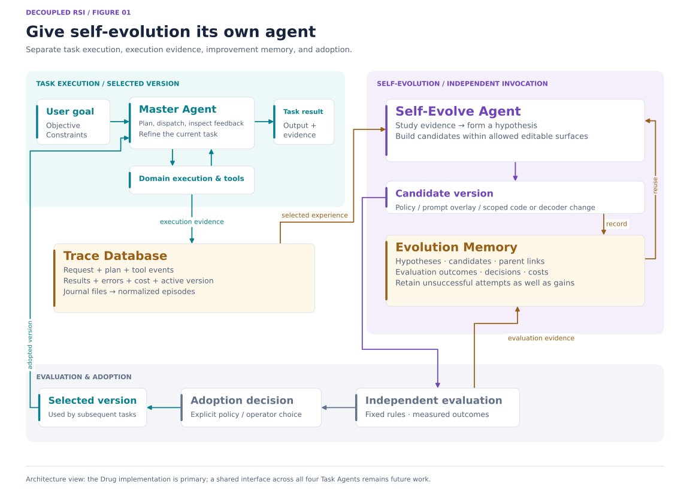
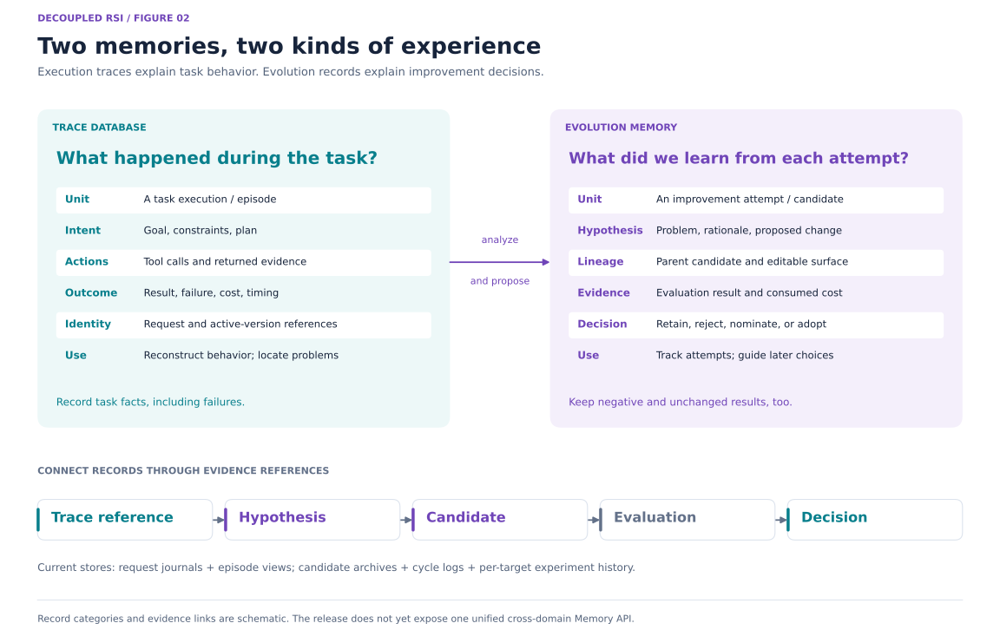
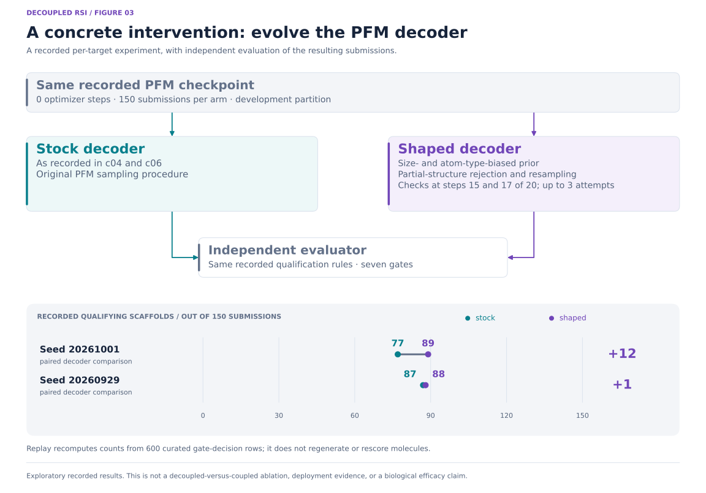
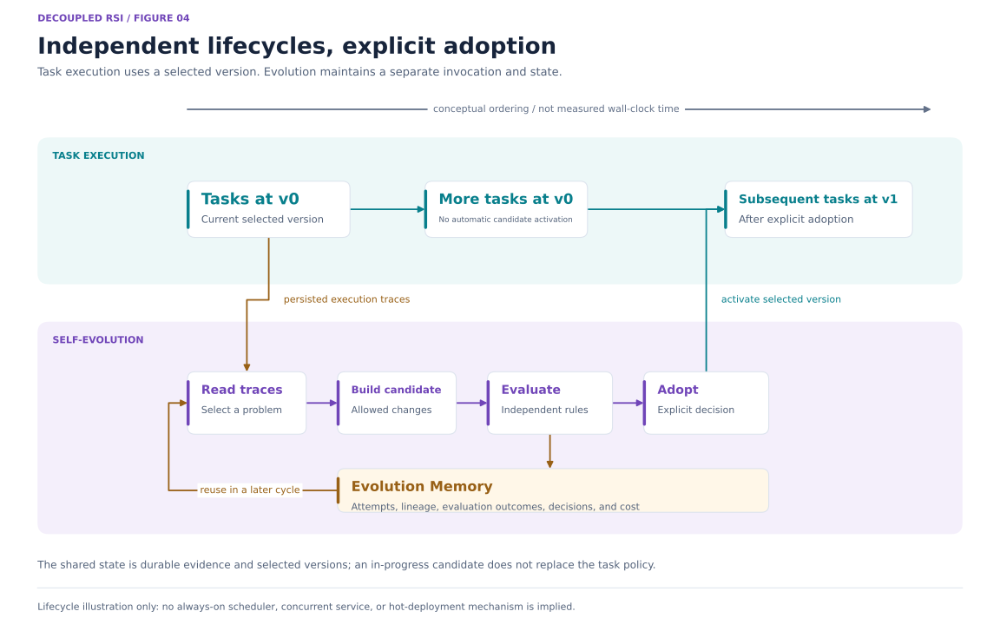

# [Updating] Decoupled RSI: Give Self-Evolution Its Own Agent

[English](README.md) | [简体中文](README_zh.md)

**A dedicated agent for improving the agents that do the work.**

Decoupled RSI separates task execution from the process of improving it. A **Master Agent** coordinates a task and records its execution in a **Trace Database**. A dedicated **Self-Evolve Agent** studies that evidence, consults its **Evolution Memory**, and proposes changes to the task system. Candidates undergo independent evaluation before an update is adopted.

This gives self-evolution its own lifecycle, budget, and persistent memory. Adopted changes shape later task execution, whose traces supply evidence for further improvement. Drug discovery is our first implementation; experimental peptide, mRNA, and enzyme Task Agents are included as additional applications.

This is an early framework source release. Controlled comparisons of decoupled and coupled self-evolution remain incomplete.



*Figure 1. Task execution, evidence storage, self-evolution, and adoption have distinct responsibilities. The drawing summarizes the architecture; a shared evolution interface across all four Task Agents is future work.*

## The architecture

A Task Agent is the application that performs domain work. In the Drug implementation, its Master Agent plans, dispatches scientific operations, inspects results, and adjusts the current task. The separate Self-Evolve Agent works on persistent improvements to that application.

| Component | Responsibility | Main record or output |
| --- | --- | --- |
| **Master Agent** | Interpret the goal, coordinate execution, and refine the current task within its budget | Plans, tool requests, task decisions, and a result |
| **Trace Database** | Preserve what actually happened, with enough context to analyze it later | Request journals, tool evidence, errors, version references, and cost |
| **Self-Evolve Agent** | Identify an improvement opportunity, formulate a hypothesis, and construct a candidate | A scoped change and the evidence motivating it |
| **Evolution Memory** | Retain improvement attempts and their outcomes for later cycles | Hypotheses, candidate lineage, evaluations, decisions, and consumed budget |
| **Independent evaluation** | Assess the candidate under the configured criteria | Measured outcomes, checks, and comparison evidence |
| **Adoption** | Select an evaluated update for subsequent execution | An explicitly selected policy or artifact version |

The Master Agent can already reflect, retry, or refine requirements inside a task. Decoupling assigns persistent system improvement to a separately invoked agent, with its own state and evaluation process.

## Why decouple self-evolution?

Task execution and system improvement ask different questions. The first asks how to complete the current request using the selected capabilities. The second asks which change to those capabilities is worth making and how its effect can be measured.

We separate four things:

| Boundary | Design intent |
| --- | --- |
| **Objectives** | Keep the current task goal distinct from the improvement hypothesis and evaluation objective |
| **Lifecycle and budget** | Invoke and budget evolution separately from task execution |
| **Context and memory** | Preserve task facts in traces and improvement experience in Evolution Memory |
| **Modification and adoption** | Make proposing, evaluating, and activating a change separate steps |

This organization makes the responsibilities easier to inspect and provides a basis for reusing improvement experience across tasks. Whether it improves cost, throughput, or generalization over a coupled design is an experimental question; this release does not establish that comparison.

## Two memories: execution experience and improvement experience

**The Trace Database stores execution experience. Evolution Memory stores improvement experience.**



*Figure 2. A task trace explains an execution. An evolution record explains an attempted change. Evidence references connect the two; the diagram is a conceptual record map, not a new shared database schema.*

### Trace Database

The execution record answers: what was requested, what did the agent do, which tools ran, and what happened?

The Drug runtime journals the request and resolved settings, model exchanges, typed events, tool usage, final outcome, and available cost measurements. The experience layer normalizes eligible request journals into episodes that the evolver can analyze. Source references allow findings to be traced back to the execution that produced them.

“Trace Database” is the architectural name used here. The current implementation uses JSON/JSONL journal files and cached episode views; it does not require a separate database server. Storage code is published, while the original private execution records are excluded.

### Evolution Memory

An improvement attempt has its own history: the hypothesis, the changed surface, the parent candidate, the evaluation, the resource cost, and the decision.

The platform implementation stores hypotheses, a candidate archive, evaluation references, and cycle logs. It checks whether a proposed candidate duplicates an existing one and retains candidate lineage. The per-target campaign implementation maintains an append-only experiment history and includes prior attempts in subsequent proposal feedback.

Failures, refused plans, and valid experiments with no improvement are useful records. Keeping them makes search behavior and budget consumption inspectable. The current implementations provide these concrete mechanisms; a unified memory and retrieval API across all Task Agents remains future work.

## One evolution cycle

1. **Read execution evidence.** Normalize eligible traces and identify recurring failures, unmet objectives, or tool-use problems.
2. **Choose a hypothesis.** Frame a specific change and the evidence that would support or refute it. Existing candidate and experiment records inform the supported history and novelty checks.
3. **Construct a candidate.** Change an allowed surface and record its relationship to the hypothesis and parent version.
4. **Evaluate independently.** Run the configured checks and evaluation against a baseline where applicable. Evaluation criteria and protected files remain outside the candidate's allowed edits.
5. **Record the outcome.** Preserve the evaluation, cost, and decision, including rejected or non-improving attempts.
6. **Adopt explicitly.** Select an eligible update through the applicable adoption interface. Subsequent tasks use the selected version and create new execution evidence.

The platform loop and the per-target campaign controller are separate implementations of this pattern. Their interfaces and records are not interchangeable. The PFM example below comes from the per-target implementation.

## What can evolve?

The useful unit of change depends on the task and the interface being evaluated.

| Surface | Example in this repository | Boundary |
| --- | --- | --- |
| **Runtime policy and prompts** | Prompt addenda and supported behavior settings | A proposed overlay is evaluated before explicit selection |
| **Scoped implementation changes** | Code patches in candidate workspaces | Changes must stay within admitted paths and preserve protected evaluation surfaces |
| **Scientific execution procedures** | PFM decoding behavior | Candidate submissions are assessed by the independent evaluator |
| **Domain-specific selection strategies** | Experimental mRNA and enzyme strategy-review workflows | These retain their own interfaces and require further integration |

Self-evolution does not require changing model weights. The PFM intervention changes how a frozen generator is used. Other changes may concern planning, tool use, or candidate selection, subject to the implementation's actual editable surfaces.

## A concrete example: PFM decoder evolution

An evolution worker changed PFM's decoding procedure. The modified decoder used a size- and atom-type-biased prior, then rejected and resampled selected partial structures. The parent evaluator assessed the submitted molecules independently of the worker's own claims.

The public extract contains two paired seeds. All four records declare the same checkpoint hash, zero optimizer steps, a 150-molecule submission budget, and an 8,000-draw ceiling. The changed decoder can produce a different molecule pool even at the same seed.



*Figure 3. Recorded development-partition comparisons of one decoder intervention. The plot uses the full 0–150 submission scale. It illustrates a concrete change and its recorded evaluation, without estimating a general efficiency advantage.*

| Seed | Stock decoder | Shaped decoder | Submitted per arm | Difference |
| --- | ---: | ---: | ---: | ---: |
| 20261001 | c04: 77 | c10: 89 | 150 | +12 |
| 20260929 | c06: 87 | c13: 88 | 150 | +1 |

The metric is **qualifying scaffolds**: distinct scaffold identities among submitted rows that pass all seven recorded gates. It measures computational yield under those rules.

Run the small replay with Python 3.11 or later:

```bash
python examples/pfm_replay/replay.py
```

It uses only the standard library and recomputes counts from 600 curated gate-decision rows. It does not download models, generate molecules, or rerun scientific scoring. Scaffold strings are represented by SHA-256 digests; original logs, molecule strings, and weights are excluded.

These exploratory records do not establish biological activity, candidate adoption, or a decoupled-versus-coupled advantage. Reproducing the underlying experiment requires additional resources. Read the [PFM example and provenance](examples/pfm_replay/README.md).

## Independent lifecycles, explicit adoption

A task run resolves a selected runtime policy. Starting an evolution cycle does not immediately replace that policy. The evolver can preserve intermediate attempts and evaluation records across invocations, and adoption selects the version intended for later execution.



*Figure 4. Conceptual ordering of execution, evolution, and adoption. This is not a measured timing diagram or a claim that an always-on scheduler, concurrent service, or hot deployment is implemented.*

The platform exposes analysis, evaluation, reporting, and promotion interfaces. Its promotion command requires evidence and an explicit operator flag, then writes an overlay for deployment to select. Per-target artifacts use their corresponding registration and adoption interfaces.

## Task Agents and applications beyond drug discovery

All Agent entrypoints in this repository are grouped under `agents/`.

| Agent | Role | Current status |
| --- | --- | --- |
| [Self-Evolve Agent](agents/self-evolve-agent/README.md) | Independent improvement entrypoint | Shares its current Python implementation with the Drug package |
| [Drug Agent](agents/drug-agent/README.md) | Primary computational drug-discovery Task Agent | Main research implementation; scientific backends require separate setup |
| [Peptide Agent](agents/peptide-agent/README.md) | Peptide design and analysis | Experimental, incomplete, needs further evolution and validation |
| [mRNA Agent](agents/mRNA-agent/README.md) | mRNA design, evaluation, and feedback | Experimental, incomplete, needs further evolution and validation |
| [Enzyme Agent](agents/Enzyme-Agent/README.md) | Enzyme design and assessment | Experimental, incomplete, needs further evolution and validation |

The Drug Master Agent is not a universal controller already dispatching all four projects. The additional Task Agents retain their own workflows; integration with a shared Self-Evolve interface is still needed.

A new domain needs four explicit interfaces: **execution evidence, editable surfaces, repeatable evaluation, and adoption**. For a software agent these might be task traces, an allowed code or policy patch, held-out task checks, and a selected release. For a data-analysis agent they might be workflow traces, a transformation strategy, reproducible evaluation datasets, and a versioned pipeline. These are extension directions, not shipped applications.

## Quickstart

**Open the unified Agent index from the repository root:**

```bash
python app.py
# Or open your browser automatically: python app.py --open
```

Visit `http://127.0.0.1:8080/` (also available at `/index.php`). The index shows live service status and starts Drug, Peptide, mRNA, Enzyme, Antibody, Self-Evolve, and Drug Dashboard on demand. Self-Evolve opens the existing evolution panel in Drug Console. All WebViews share visual styles, light/dark themes, and navigation back to the index while retaining their native APIs, downloads, and event streams.

The index requires only Python 3.10+ and its standard library. Install each Agent's runtime separately. The launcher first honors `DRUGAGENT_PYTHON`, `PEPTIDE_PYTHON`, `MRNA_PYTHON`, `ENZYME_PYTHON`, and `ANTIBODY_PYTHON`, then searches project virtual environments, installed local environments, and the current Python. Child processes inherit model/data environment settings; load any existing machine configuration in your terminal first.

Default Agent ports are Dashboard `2000`, Drug / Self-Evolve `2001`, Peptide `2004`, mRNA `2005`, Enzyme `2006`, and Antibody `2007`. Use `--port 8088` for a different index port or `--port-offset 10000` to shift all Agent ports. Matching running services are reused. Closing the index stops only services it started. Use `--data-dir /path/to/preview-stores` for separate preview run stores.

Preview mode with `--data-dir` requires unused Agent ports and does not reuse external services' data directories. The canonical visual assets are `web/shared.css` and `web/shared.js`. After editing them, run `python scripts/sync_web_theme.py` to update the assets bundled in each standalone Agent. Use `--check` to verify synchronization. Run index regression checks with `python scripts/check_web_hub.py`.

Commands in this section assume the public repository root in a standalone checkout such as `decoupled-rsi-agent`.

**Replay the recorded example without installing scientific dependencies:**

```bash
python examples/pfm_replay/replay.py
python examples/pfm_replay/replay.py --json
```

**Install the primary runtime and inspect it:**

```bash
./install.sh --help
./install.sh core
conda activate drug-agent
make doctor
make demo
```

The offline drug demo uses [synthetic fixtures](agents/drug-agent/fixtures/data/DATA_CARD.md). Scientific model sources, weights, tool environments, and data are separate dependencies.

**Inspect the independent evolution entrypoint and dependency plans:**

```bash
./agents/self-evolve-agent/run.sh --help
./install.sh dependency drug --plan pfm
./install.sh dependency peptide --help
./install.sh dependency mrna --help
./install.sh dependency enzyme --help
```

See the [installation guide](docs/dependencies.md), [Self-Evolve guide](docs/self-evolution.md), and [third-party installers and file layouts](THIRD_PARTY.md).

## Repository and implementation map

```text
agents/
  self-evolve-agent/     independent install and invocation entrypoint
  drug-agent/           primary task runtime and shared evolution implementation
  peptide-agent/        experimental peptide application
  mRNA-agent/           experimental mRNA application
  Enzyme-Agent/         experimental enzyme application
third_party/            family-specific installers, manifests, resource layouts
examples/pfm_replay/     curated recorded-evaluation replay
docs/                   architecture, interfaces, and installation guides
```

| Architecture concept | Current Drug implementation |
| --- | --- |
| Master Agent | [`agents/llm/master_agent.py`](agents/drug-agent/src/drug_agent/agents/llm/master_agent.py) |
| Trace records | [`observability/journal.py`](agents/drug-agent/src/drug_agent/observability/journal.py) |
| Normalized execution experience | [`selfevolve/experience/`](agents/drug-agent/src/drug_agent/selfevolve/experience/) |
| Platform evolution controller | [`selfevolve/controller/loop.py`](agents/drug-agent/src/drug_agent/selfevolve/controller/loop.py) |
| Candidate archive and lineage | [`selfevolve/archive/archive.py`](agents/drug-agent/src/drug_agent/selfevolve/archive/archive.py) |
| Per-target controller and experiment history | [`selfevolve/target/controller.py`](agents/drug-agent/src/drug_agent/selfevolve/target/controller.py) |
| Evaluation and promotion | [`selfevolve/evaluation/`](agents/drug-agent/src/drug_agent/selfevolve/evaluation/) · [`selfevolve/promotion/`](agents/drug-agent/src/drug_agent/selfevolve/promotion/) |

## Current status and next steps

The release contains framework source, task implementations, dependency installers, and the small PFM replay. It excludes original execution history, development tests, third-party source trees, model weights, and private campaign inputs.

The current full platform evolution loop still requires the excluded private regression suite at **gate 0**. A fresh public checkout cannot pass that gate without a compatible supplied suite or a deliberately integrated invariant-checking implementation. The check is preserved. Some experimental backends also require local readiness evidence that is not distributed. A fresh scientific installation and new GPU/LLM experiments were not performed as part of this release preparation.

Use an installation path without `:`; the title-named review folder can conflict with Unix `PYTHONPATH` in candidate subprocesses.

Next steps include:

- Controlled decoupled-versus-coupled comparisons with matched tasks and budgets.
- An ablation of Evolution Memory's contribution to subsequent improvement attempts.
- Clearer reusable contracts for traces, candidates, evaluation, and adoption.
- Integration and validation of the experimental Task Agents.
- A public evaluation path with reproducible inputs and portable regression checks.

The architecture offers a concrete implementation to examine and extend. Comparative efficiency and cross-domain transfer remain open questions.

## Related work

Google's Harness² distinguishes execution and improvement harnesses, combining task-level refinement with persistent experience for future tasks. See the [official repository](https://github.com/google-research/harness2) and [paper](https://arxiv.org/html/2610.14224v1).

Decoupled RSI emphasizes a separately invoked Self-Evolve Agent, execution traces distinct from improvement memory, and explicit evaluation and adoption boundaries. We position these as architectural choices to study; the present example does not establish superiority over Harness² or other RSI systems.

## License and dependencies

First-party code retains the [Apache-2.0 license](LICENSE). Third-party code, models, and datasets retain their own terms. [THIRD_PARTY.md](THIRD_PARTY.md) connects each integration to installation commands, expected files, and remaining manual requirements.

---

**Figure sources:** all four figures have SVG and PNG exports in [`docs/assets/decoupled-rsi/`](docs/assets/decoupled-rsi/). The editable [rendering script](docs/assets/decoupled-rsi/render_figures.py) reproduces them with Matplotlib and reads the PFM counts from the curated public example. Figure labels are shared in English across both language versions.
