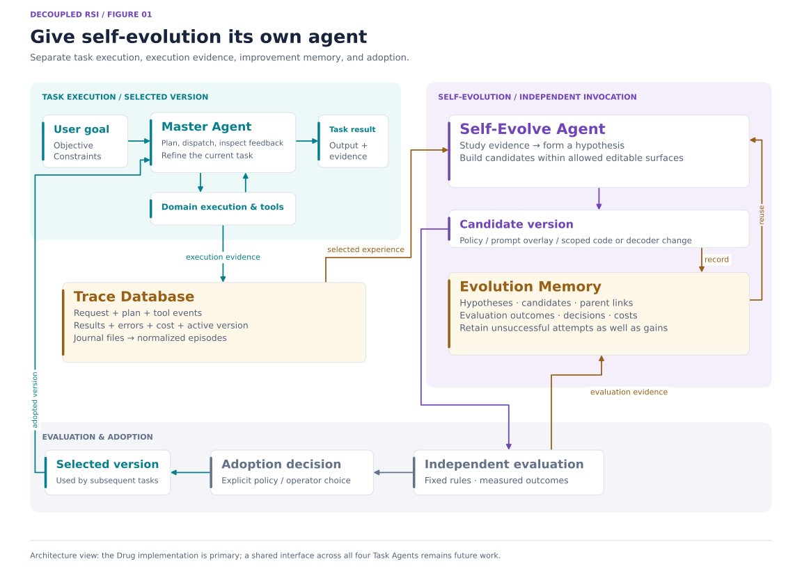
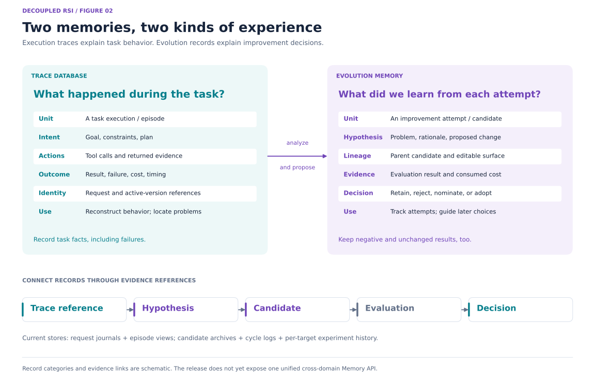
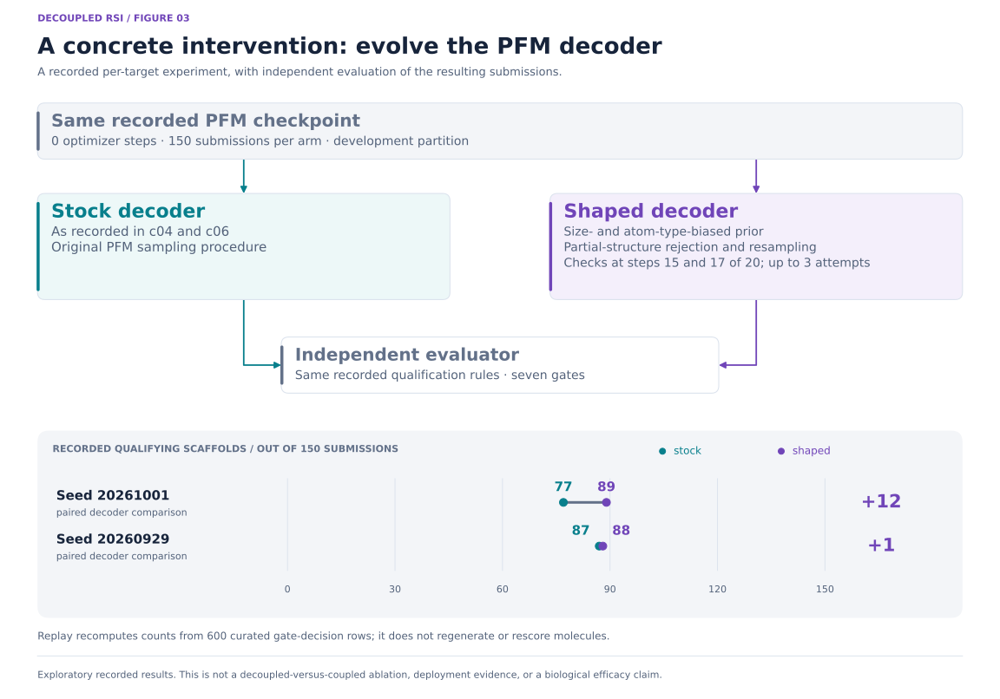
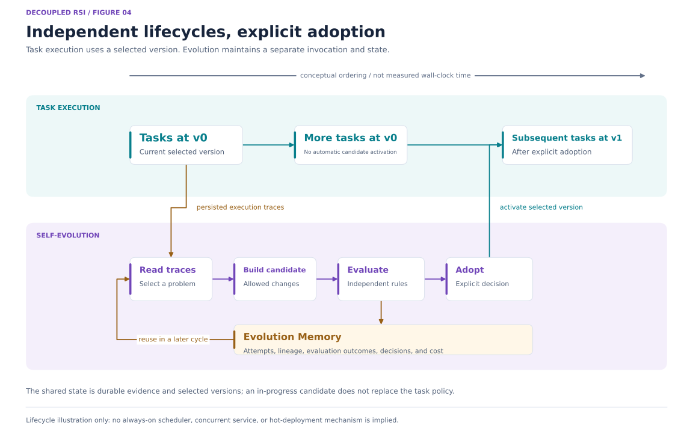

# 【更新中】Decoupled RSI：让自进化拥有自己的 Agent

[English](README.md) | [简体中文](README_zh.md)

**让专门的 Agent，持续改进执行任务的 Agent。**

Decoupled RSI 将任务执行与改进任务系统的过程解耦。**Master Agent** 协调任务，把执行过程记录到 **Trace Database（执行轨迹库）**。独立的 **Self-Evolve Agent** 分析这些证据，结合自己的 **Evolution Memory（进化记忆）**，提出对任务系统的改动。候选改动先接受独立评估，再决定是否采纳更新。

这种分离让自进化拥有自己的生命周期、预算和持久记忆。采纳的改动影响后续任务执行，新产生的轨迹又成为进一步改进的证据。药物发现是我们的首个实现；仓库同时包含实验性的肽、mRNA 和酶 Task Agent。

这是一次早期框架源码发布。解耦与非解耦自进化的受控比较仍不充分。



*图 1：任务执行、证据存储、自进化和更新采纳各有明确职责。此图概括架构关系；贯通四个 Task Agent 的共享进化接口仍是后续工作。*

## 系统架构

Task Agent 是完成领域工作的应用。在 Drug 实现中，Master Agent 负责规划、调度科学操作、检查结果并调整当前任务。独立的 Self-Evolve Agent 则负责对这个应用进行可持续保留的改进。

| 组件 | 职责 | 主要记录或输出 |
| --- | --- | --- |
| **Master Agent** | 理解目标、协调执行，在预算内调整当前任务 | 计划、工具请求、任务决策与结果 |
| **Trace Database** | 保存实际发生的过程及后续分析所需的上下文 | 请求日志、工具证据、错误、版本引用与成本 |
| **Self-Evolve Agent** | 找到改进机会，形成假设并构建候选 | 范围明确的改动及其依据 |
| **Evolution Memory** | 保留改进尝试与结果，供后续进化使用 | 假设、候选谱系、评估、决策与已消耗预算 |
| **独立评估** | 按配置的标准评判候选 | 测量结果、检查结果与比较证据 |
| **采纳机制** | 选择经过评估的更新，供后续任务使用 | 显式选定的策略或产物版本 |

Master Agent 本身仍可在任务内反思、重试或细化要求。解耦将持久的系统改进职责交给单独调用的 Agent，由它维护自己的状态和评估过程。

## 为什么将自进化解耦

任务执行与系统改进回答不同的问题。前者关注怎样使用已选定的能力完成当前请求；后者关注对这些能力作出什么改动值得尝试，以及怎样测量改动的效果。

我们明确分离四个方面：

| 边界 | 设计意图 |
| --- | --- |
| **目标** | 区分当前任务目标、改进假设和评估目标 |
| **生命周期与预算** | 任务执行和进化分别调用、分别分配预算 |
| **上下文与记忆** | 轨迹保留任务事实，Evolution Memory 积累改进经验 |
| **修改与采纳** | 将提出改动、评估改动、启用改动分成明确步骤 |

这样的组织使各组件职责更容易检查，并为跨任务复用改进经验提供基础。相较耦合设计，是否能够改善成本、吞吐量或泛化，仍需通过实验回答；本次发布没有确立这一比较结论。

## 两类记忆：执行经验与改进经验

**Trace Database 保存执行经验，Evolution Memory 保存改进经验。**



*图 2：任务轨迹解释一次执行，进化记录解释一次改动尝试。证据引用将两者连接起来；此图展示概念上的记录关系，不表示新增了统一数据库 schema。*

### Trace Database：任务实际如何执行

执行记录回答：用户要求什么，Agent 做了什么，调用了哪些工具，最终发生了什么。

Drug 运行时记录请求与解析后的设置、模型交互、类型化事件、工具使用、最终结果及可获得的成本测量。经验层将符合条件的请求日志规范化为 episode，供进化器分析。来源引用使分析发现能够追溯到产生它的执行过程。

本文用 Trace Database 指代这一架构角色。当前实现采用 JSON/JSONL 日志文件和缓存的 episode 视图，不需要单独部署数据库服务器。存储代码公开，原始私有执行记录不随仓库发布。

### Evolution Memory：改进尝试留下了什么

每次改进尝试都有自己的历史：假设、被修改的范围、父候选、评估结果、资源成本和最终决策。

平台实现保存假设、候选归档、评估引用和循环日志，检查新提案是否重复已有候选，并保留候选谱系。按靶点组织的研究控制器则维护仅追加的实验历史，并把既往尝试纳入后续提案反馈。

失败、被拒绝的计划，以及有效执行但没有改善的实验，都属于有价值的记录。保留它们，才能检查搜索过程和预算消耗。当前实现已具备上述具体机制；贯通所有 Task Agent 的统一记忆与检索 API 仍是后续工作。

## 一次进化如何进行

1. **读取执行证据。** 将符合条件的轨迹整理成经验，识别反复失败、目标未满足或工具使用问题。
2. **选择改进假设。** 明确要改变什么，以及哪些证据能够支持或否定该假设。已有候选与实验记录参与当前实现支持的历史反馈和重复性检查。
3. **构建候选。** 修改允许的范围，记录候选与假设、父版本之间的关系。
4. **独立评估。** 执行配置的检查和评估，在适用时与基线比较。评估标准和受保护文件不属于候选可修改范围。
5. **保存结果。** 保留评估、成本与决策，包括被拒绝或没有改善的尝试。
6. **显式采纳。** 通过对应采纳接口选择符合条件的更新。后续任务使用选定版本，并产生新的执行证据。

平台循环与按靶点组织的研究控制器是这一模式的两种独立实现，接口和记录并不互通。下文 PFM 示例来自按靶点组织的实现。

## 可以进化什么

合适的改动单元取决于任务，以及当前接受评估的接口。

| 可修改范围 | 仓库中的例子 | 边界 |
| --- | --- | --- |
| **运行策略与提示** | 提示附加内容及受支持的行为设置 | 候选覆盖层经过评估后，再被显式选用 |
| **限定范围的实现改动** | 候选工作区内的代码补丁 | 改动须位于允许路径内，并保留受保护评估部分 |
| **科学执行流程** | PFM 解码行为 | 提交结果由独立评估器判定 |
| **领域特定的选择策略** | 实验性 mRNA 和 Enzyme 策略审查工作流 | 保留各自接口，仍需进一步整合 |

自进化不要求一定改变模型权重。PFM 干预改变了使用冻结生成器的方式。其他改动可以涉及规划、工具使用或候选选择，具体以实现实际允许修改的范围为准。

## 一个具体实例：PFM 解码器进化

进化 worker 修改了 PFM 的解码流程：调整后的解码器采用带尺寸与原子类型偏置的先验，并对选定的部分结构进行拒绝和重采样。父评估器独立评价提交的分子，不依赖 worker 对自身结果的声明。

公开摘录包含两个配对种子。四条记录均声明使用同一 checkpoint 哈希、零优化器更新步、150 个分子的提交预算和 8,000 次抽样上限。即便采用相同种子，改变解码器也可能产生不同分子池。



*图 3：development 分区中一次解码器干预的已记录配对结果。横轴采用完整的 0–150 提交范围。此图展示具体改动及其评估记录，不估计普遍的效率优势。*

| 种子 | 原始解码器 | 调整后的解码器 | 每个实验臂的提交数 | 差值 |
| --- | ---: | ---: | ---: | ---: |
| 20261001 | c04：77 | c10：89 | 150 | +12 |
| 20260929 | c06：87 | c13：88 | 150 | +1 |

指标是**合格骨架数**：提交行中，通过全部七个已记录关卡的不同骨架数。它衡量的是这些规则下的计算产出。

使用 Python 3.11 或更新版本即可运行最小回放：

```bash
python examples/pfm_replay/replay.py
```

回放只使用标准库，根据 600 行整理后的关卡判定重新计算计数，不下载模型、不生成分子，也不重新执行科学评分。骨架字符串以 SHA-256 摘要表示；原始日志、分子字符串和权重均不包含在内。

这些探索性记录不能证明生物活性、候选已被采纳，或解耦优于非解耦。复现底层实验需要额外资源。详见 [PFM 示例与来源说明](examples/pfm_replay/README_zh.md)。

## 独立生命周期，显式采纳更新

任务运行时解析并使用选定的策略。启动一次进化不会立即替换该策略。进化器可以跨调用保留中间尝试和评估记录，采纳环节则选定后续执行使用的版本。



*图 4：执行、进化和采纳的概念顺序。这不是实测时序图，也不表示已经实现常驻调度器、并发服务或热部署。*

平台提供分析、评估、报告和晋升接口。晋升命令要求评估证据及显式操作者标志，再写出供部署选择的覆盖层。按靶点组织的产物使用对应的注册与采纳接口。

## Task Agent 与药物发现之外的应用

所有 Agent 入口集中在 `agents/`。

| Agent | 职责 | 当前状态 |
| --- | --- | --- |
| [Self-Evolve Agent](agents/self-evolve-agent/README_zh.md) | 独立的改进入口 | 当前 Python 实现与 Drug 包共享 |
| [Drug Agent](agents/drug-agent/README_zh.md) | 主要的计算药物发现 Task Agent | 主要研究实现；科学后端需要单独配置 |
| [Peptide Agent](agents/peptide-agent/README_zh.md) | 肽设计与分析 | 实验性，尚不完善，需要继续进化和验证 |
| [mRNA Agent](agents/mRNA-agent/README_zh.md) | mRNA 设计、评估与反馈 | 实验性，尚不完善，需要继续进化和验证 |
| [Enzyme Agent](agents/Enzyme-Agent/README_zh.md) | 酶设计与评估 | 实验性，尚不完善，需要继续进化和验证 |

Drug Master Agent 尚不是调度全部四个项目的通用控制器。其他 Task Agent 保留各自工作流，仍需接入共享的 Self-Evolve 接口。

新的领域需要明确四类接口：**执行证据、允许修改的范围、可重复评估和更新采纳**。软件工程 Agent 可以将它们对应为任务轨迹、允许的代码或策略补丁、留出任务检查和选定的发布版本；数据分析 Agent 可以对应为工作流轨迹、变换策略、可复现评估数据集和版本化流水线。这些是扩展方向，并非已经随仓库提供的应用。

## 快速开始

本节命令假定工作目录为公开仓库独立 checkout 的根目录，例如 `decoupled-rsi-agent`。

**无需安装科学依赖，回放已记录示例：**

```bash
python examples/pfm_replay/replay.py
python examples/pfm_replay/replay.py --json
```

**安装并检查主要运行环境：**

```bash
./install.sh --help
./install.sh core
conda activate drug-agent
make doctor
make demo
```

离线药物演示使用[合成 fixtures](agents/drug-agent/fixtures/data/DATA_CARD_zh.md)。科学模型源码、权重、工具环境和数据是独立依赖。

**查看独立进化入口和依赖计划：**

```bash
./agents/self-evolve-agent/run.sh --help
./install.sh dependency drug --plan pfm
./install.sh dependency peptide --help
./install.sh dependency mrna --help
./install.sh dependency enzyme --help
```

详见[安装指南](docs/dependencies_zh.md)、[Self-Evolve 指南](docs/self-evolution_zh.md)和[第三方安装器与文件结构](THIRD_PARTY_zh.md)。

## 仓库与实现导航

```text
agents/
  self-evolve-agent/     独立安装与调用入口
  drug-agent/           主要任务运行时与共享进化实现
  peptide-agent/        实验性肽应用
  mRNA-agent/           实验性 mRNA 应用
  Enzyme-Agent/         实验性酶应用
third_party/            各类安装器、依赖清单和资源结构
examples/pfm_replay/     整理后的已记录评估回放
docs/                   架构、接口和安装指南
```

| 架构概念 | 当前 Drug 实现 |
| --- | --- |
| Master Agent | [`agents/llm/master_agent.py`](agents/drug-agent/src/drug_agent/agents/llm/master_agent.py) |
| 执行轨迹 | [`observability/journal.py`](agents/drug-agent/src/drug_agent/observability/journal.py) |
| 规范化执行经验 | [`selfevolve/experience/`](agents/drug-agent/src/drug_agent/selfevolve/experience/) |
| 平台进化控制器 | [`selfevolve/controller/loop.py`](agents/drug-agent/src/drug_agent/selfevolve/controller/loop.py) |
| 候选归档与谱系 | [`selfevolve/archive/archive.py`](agents/drug-agent/src/drug_agent/selfevolve/archive/archive.py) |
| 按靶点组织的控制器与实验历史 | [`selfevolve/target/controller.py`](agents/drug-agent/src/drug_agent/selfevolve/target/controller.py) |
| 评估与晋升 | [`selfevolve/evaluation/`](agents/drug-agent/src/drug_agent/selfevolve/evaluation/) · [`selfevolve/promotion/`](agents/drug-agent/src/drug_agent/selfevolve/promotion/) |

## 当前状态与下一步

本次发布包含框架源码、任务实现、依赖安装器及小型 PFM 回放，排除了原执行历史、开发测试、第三方源码树、模型权重和私有研究输入。

当前完整平台进化循环的 **gate 0** 仍要求被排除的私有回归套件。全新公开 checkout 必须提供兼容套件，或有意识地接入自己的不变量检查实现，才能通过这一关卡；检查没有被绕过。部分实验性后端还要求未分发的本地就绪证据。本次发布准备没有重新安装科学环境，也没有开展新的 GPU/LLM 实验。

安装路径请不要包含 `:`；以标题命名的审阅目录可能在候选子进程中与 Unix `PYTHONPATH` 冲突。

后续工作包括：

- 在匹配任务和预算的条件下，比较解耦与非解耦结构。
- 消融 Evolution Memory 对后续改进尝试的贡献。
- 提供更清晰、可复用的轨迹、候选、评估与采纳契约。
- 整合并验证实验性 Task Agent。
- 提供具有可复现输入和可移植回归检查的公开评估路径。

当前架构提供了可检查、可扩展的具体实现。相对效率与跨领域迁移仍是开放问题。

## 相关工作

Google 的 Harness² 区分执行 harness 与改进 harness，将任务内优化与供后续任务使用的持久经验结合起来。参见[官方仓库](https://github.com/google-research/harness2)与[论文](https://arxiv.org/html/2610.14224v1)。

Decoupled RSI 强调单独调用的 Self-Evolve Agent、与改进记忆分开的执行轨迹，以及明确的评估与采纳边界。我们将这些作为值得研究的架构选择；当前示例没有证明相较 Harness² 或其他 RSI 系统的性能优势。

## 许可证与依赖

本项目代码沿用 [Apache-2.0 许可证](LICENSE)。第三方代码、模型和数据集适用各自条款。[THIRD_PARTY_zh.md](THIRD_PARTY_zh.md) 将各项集成对应到安装命令、预期文件和仍需手工处理的要求。

---

**图源：** 四张图均在 [`docs/assets/decoupled-rsi/`](docs/assets/decoupled-rsi/) 中提供 SVG 和 PNG 导出。可编辑的[绘图脚本](docs/assets/decoupled-rsi/render_figures.py) 使用 Matplotlib 重绘，并从公开整理示例读取 PFM 计数。两种语言的文档共用英文标注配图。
