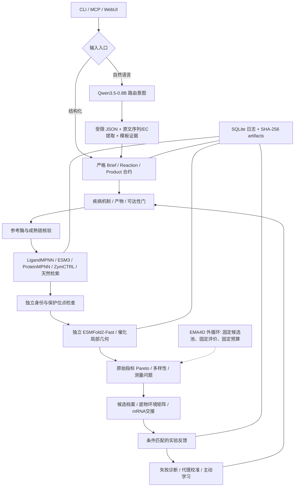

# Pipeline 与边界

[原文](architecture.md) | [简体中文](architecture_zh.md)

实现对应 drug-agent 的 decision plane、typed contracts、tool registry、evidence journal、independent evaluator，以及 peptide-agent 的 Qwen schema 解码、后台科学子进程和本地研究台。Enzyme 包不导入 drug-agent 或 peptide-agent 的业务模块；只复用同一模型文件与基础 Python 依赖。

`workflow.py` 维护 durable checkpoints；`gateway.py` 限制固定工具名、请求 schema、单任务调用数和时间；`science_worker.py` 调用固定 Python 入口。模型推理子进程共享 GPU 文件锁，避免 CLI/MCP/WebUI 同时占用模型显存。每个 run 单独加排他锁，Web 服务重启仅恢复已失去执行者的任务。

成功生成按模型分别保存，折叠按候选身份保存。恢复会重用成功 checkpoint，但崩溃发生在工具完成、结果入库前时仍可能重复调用，因此为 at-least-once，不宣称 exactly-once。失败尝试计入预算，恢复不会重置。

输入 Bio/产品数据不直接决定已验证状态。生成模型只给候选；ProtParam 给描述符；ESMFold2 给预测结构与置信度；静态 RMSD 给参考相容性。疾病底物、保护底物、产物后果、定位、糖基化占据与免疫均保留独立证据缺口。生成时的几何条件不被重新计为独立证据。

固定评价源码包括 contracts、evaluation、feedback、benchmark、structure、tool_evaluation、stability、folding、workflow 九个模块，并保存源码 artifact 与 SHA-256。外循环只改变候选选择策略，不更改标准、标签状态、对照或拆分。候选内循环保存 `parent_run_id`，失败原因决定继续序列工程还是回到机制/构型/递送问题。

数据合约承载前体、成熟链、修饰、寡聚、定位与依赖；多环境/多底物证据按 ID 分开。产品变化产生新身份；实验观测以候选、产品、原始测量来源、批次、重复、条件和终点去重。跨项目可关联相同序列，不能把不同产品/条件的结果合成一个活性标签。

## 强制评估修订

生成后，所有序列硬约束合格候选（包括亲本）必须独立 ESMFold2 折叠并经过结构工具检查；可映射到亲本结构的保守替换还必须运行 ThermoMPNN。提名只接收 evaluation.status=passed。工具缺失/失败与数值筛选失败分别记录，旧 fold_candidates 无法跳过此步骤。固定评价器源码现在包含 workflow、folding、tool_evaluation 和 stability，不能跨版本悄悄复用旧提名。

RFdiffusion3 使用独立 Python 3.12 Foundry 子进程，参考结构中的非可变区域显式固定；生成坐标随来源保存，独立折叠只输入最终序列。RFD3 与 ThermoMPNN 的 ready 状态以真实推理验证记录为条件。

This experimental package has its own fixed-budget strategy review. It is not
yet a complete integration with the shared Self-Evolve Agent. No historical
run records or internal validation artifacts are included in this public copy.
