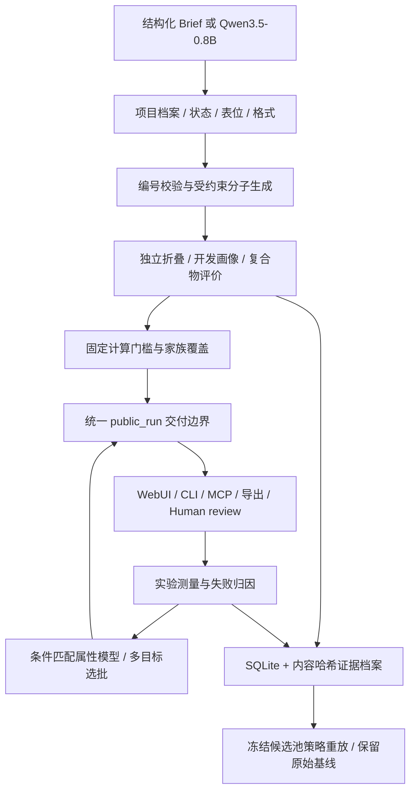

# 架构、证据边界和验收

本实现从仓库 `docs/development.md` 的独立包、显式发布资源与本地运行环境约定出发，
只在 `agents/antibody-agent` 内增加文件。设计依据是同目录的抗体功能蓝本；流水线和
研究工作台参考 Enzyme、mRNA、peptide agent，但不导入这些包的实现。

| 文件 | 职责 |
| --- | --- |
| `contracts.py` | 严格项目、链、编号、格式、抗原、表位、证据、实验合约 |
| `llm.py` / `decoding.py` | 固定 0.8B 主控，结构化约束解码，实体/序列逐字提取 |
| `registry.py` | 实际职责、格式范围、版本、许可来源和配置状态 |
| `adapters.py` / `science_worker.py` | 原生科学模型执行和独立进程入口 |
| `gateway.py` | 工具白名单、版本化桥接、超时、取消、输入输出哈希与持久化预算 |
| `workflow.py` | 可恢复流水线、编号预检、候选来源、独立评价、human 前交付 |
| `structure.py` | 真实 PDB 序列核对、CA 几何冲突与抗原接触检查 |
| `evaluation.py` | 不可变身份、修改范围、格式/多状态门槛、独立性与家族选择 |
| `delivery.py` / `exports.py` | 所有公开渠道共用的交付限制与格式明确的导出 |
| `store.py` | SQLite 任务/工具/事件/测量账本与内容寻址档案 |
| `feedback.py` | 追加实验、分组分母、失败诊断、显式 human 决定 |
| `learning.py` | 冻结实验拆分、条件匹配 Ridge/conformal、Pareto/家族探索 |
| `benchmark.py` | 同池同预算流程重放，拒绝代理指标自动升级 |
| `web.py` / `web/` | 本地异步队列、轮询、桌面/移动工作台与本地结构画布 |

## 不可绕过的约束

1. 一个候选是配对 VH/VL 或明确的 VHH。普通单 VH 不自动变成 VHH。
2. 可变区身份与完整构型身份分开；完整身份包含链序列、角色、格式、Fc、连接/融合/偶联字段。
3. 编号必须覆盖序列并可逆；候选修改超出允许标签、保护位点或数量时不能交付。
4. 生成器中的 RF2 或逆折叠分数不能取代独立复核。复核不接受设计模板或强制接触。
5. 复合物记录按候选和完整抗原状态绑定。使用抗体—抗原的界面置信度，避免把 VH/VL
   配对界面的高分当成抗原识别证据。
6. TAP/TNP 是必需的格式适配画像。序列 motif 检查独立标注，不能伪称完整开发评价。
7. 缺少结构、版本、天然背景、画像或其他必需项时 fail closed。无法运行是工程/输入状态，
   不能转换成生物学失败或低亲和力。
8. `public_run` 每次从工具结果重算门槛。所有公开候选、结构、序列文件与属性选批都走此入口。
9. 改变评价器代码、项目档案、候选身份或工具输出后，历史结果不能直接交付，必须新建评价。
10. 断点恢复保留工具调用记录与已花时间。取消会停止正在运行的工具进程组；同一 run 有文件锁。
11. human 决定是追加的研究决策，不能把预测提升为实测。

哈希用于检测身份/版本漂移与文件损坏，不是对恶意本机数据库管理员的数字签名安全承诺。
运行目录是受信任的本地科研资产。

## 科学适用范围

本版交付的是可追溯的计算优先候选，序列明确标为 variable domains；不声称已设计全长 IgG
的效应功能或药代。结构检查是 **CA 层面** 的碰撞和接触检查，不是完整全原子能量分析。
默认置信门槛是未校准的计算筛选规则。缺失糖链/膜背景作为未知保留；已声明这些背景已知时，
需要专用适配器证明确实进行对应空间检查。

天然环境、全分子装配、复杂格式、选择性、人源化后结合保持和免疫原性仍需要相应工具及
实验。用户可导入来源明确的证据，系统不会根据疾病名称自动编造靶点因果关系或文献。
当前固定池策略比较不能证明前瞻性命中率提升；没有独立收益时不自动推广系统改动。

## 验证方式

软件测试覆盖生成结果交付隔离、格式/状态身份失效、约束和编号错误、失败工具、预算与恢复、
实验记录原子性、删失分母、属性模型拆分泄漏和实际 HTTP 队列。测试中的成功模型响应有明确
的 synthetic 标识，只用于协议验证。

本地验收还应分别记录：0.8B 真实规划、真实分子模型推理、真实实验性质校准、前瞻实验。
某一层通过不会自动给其他层背书。部署者应使用 `doctor`、工具调用账本和模型自带的真实
回归输入逐一建立运行证据。
