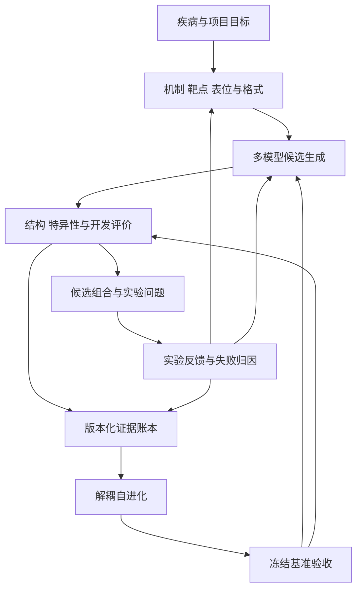

**定位：EMA4D Antibody Agent。** 面向治疗性抗体发现与先导优化，供 coding agent 据此实现。资料核对日期：2026 年 10 月 25 日。本文规定功能、模型职责、决策规则、输出和验收；不包含代码、候选序列或湿实验操作流程。

核心目标是在预先约定的计算与实验预算内，提出具有明确疾病作用机制、能够识别天然靶标、具有开发可行性且相互不同的抗体候选家族，并通过实验反馈持续改进。系统交付的是可追溯的候选与证据包；证据等级随验证逐级提高。

**推荐核心组合：RFantibody、BoltzGen、IgGM 负责互补的从头生成；IgDesign、AntiFold 负责结构约束序列优化；p-IgGen、LICHEN 负责配对序列与轻链设计；Sapiens、Humatch 负责人源化基线；有实验数据后采用 LaMBO-2 风格的多目标主动学习。** 结构、成药性和实验评价作为独立模块运行。下面的优先级是系统设计建议，不是这些模型在所有抗原上的性能排名。

# 1 设计对象与成功定义

## 1 1 一个候选必须代表完整的治疗假设

候选对象由六部分组成：

1. 疾病及患者亚群：在哪种病理环境下、希望改善哪个表型。

2. 靶标实体与状态：具体蛋白、物种、亚型、成熟体、突变、复合物及天然呈递方式。

3. 功能表位与作用方向：结合哪里，为什么有望阻断、激动、清除、桥联或递送。

4. 结合模块：配对 VH/VL，或 VHH；CDR、框架和可修改区域。

5. 最终药物格式：IgG、Fab、scFv、VHH、融合体或多特异格式，以及价态、Fc 需求。

6. 证据与版本：哪些是实验事实，哪些是模型预测，哪些仍是机制假设。

**相同序列在不同格式、抗原状态或实验条件下，必须拥有不同的评价记录。** 改变 Fc、价态、轻链或连接方式后，受影响的结论要重新评价。

## 1 2 基本术语与生成边界

| 对象 | 本系统中的含义 |
| - | - |
| VH 与 VL | 常规抗体的重链与轻链可变区；以明确记录的组合为设计单位，并注明天然观测、实验确认或模型提议的配对来源 |
| Fv | VH/VL 组成的可变区结合模块，不包含完整 Fc |
| VHH | 单域抗体结合模块；不能把普通 VH 直接当作功能等价的 VHH |
| CDR | 重点参与识别的可变环；允许固定、局部修改或重新生成 |
| Framework | 支撑 CDR 的框架；其中可能包含影响结合构象、配对和稳定性的关键位置 |
| Epitope 与 paratope | 抗原上被识别的区域与抗体上参与识别的区域 |
| Fc 与最终格式 | 参与效应功能、体内行为和分子组织方式的设计层，需要独立处理 |

“全原子生成”描述分子表示；“完整可变区生成”描述序列范围。二者都不能自动解释为“已经完成具有预期功能与药代性质的全长 IgG 设计”。RFantibody、BoltzGen、IgGM 的具体任务边界见官方说明：[RFantibody](https://github.com/RosettaCommons/RFantibody)、[BoltzGen](https://github.com/HannesStark/boltzgen)、[IgGM](https://github.com/TencentAI4S/IgGM)。

## 1 3 分别评价五种成功

| 成功维度 | 需要回答的问题 |
| - | - |
| 结合成功 | 是否有可靠的靶标结合证据 |
| 表位成功 | 是否识别指定的功能表位 |
| 姿态成功 | 若项目承诺结构可控性，实际结合方式是否符合设计 |
| 机制成功 | 是否产生所需阻断、激动、清除、桥联或递送作用 |
| 开发成功 | 在相应格式下是否满足表达、稳定性、特异性等阶段要求 |

结合、表位和姿态需要独立存储。系统不能用一个“binding score”代替全部结论。

# 2 用户入口与项目约定

## 2 1 五种输入模式

| 用户已知信息 | Agent 应完成的工作 |
| - | - |
| 只有疾病或机制问题 | 梳理靶点与作用方向，判断抗体适用性，提出可比较的治疗假设 |
| 已有靶点但没有先导 | 建立抗原状态与表位组合，开展从头生成 |
| 已有抗体序列 | 整理配对、推断结构，提出保留功能的优化分支 |
| 已有抗体—抗原复合物 | 开展结构约束的 CDR 与局部框架重设计 |
| 已有实验结果或失败记录 | 诊断失败原因，更新属性模型与下一轮候选选择 |

用户不必先提供全部字段。系统先建立可工作的草案，只将会改变科学路线的重要缺项列为待决事项，例如抑制还是激活、是否必须保留既有表位、是否允许改变药物格式。

## 2 2 项目目标档案

每个项目启动时形成 Target Product Profile，至少包含：

- 适应证、患者亚群、作用组织与目标细胞。

- 预期作用机制及关键功能终点。

- 靶标身份、希望识别的状态、必须避免的状态。

- 给药场景对浓度、稳定性、分子大小与持续时间的要求；此处记录需求，不凭模型生成临床方案。

- 首选格式和备选格式；Fc 效应功能需要保留、降低还是增强。

- 对照抗体、已有先导或其他适当的参考方案。

- 结合动力学、功能效力、特异性和开发性质的目标范围。

- 允许修改的区域、必须保留的功能与最大允许改动程度。

- 计算预算、可送验数量与阶段停止条件。

- 每个目标的证据来源和不确定性。

亲和力目标应为项目相关的范围；对价态、细胞表面密度或受体聚簇敏感的机制，应同时考虑作用几何和功能读数。

# 3 总体架构

采用“项目主控 + 专业模块 + 共享证据账本 + 解耦自进化”的结构。这里的 Agent 是独立功能职责，不要求每个模块都由一个独立大语言模型实现。确定性校验交给规则工具，分子生成交给生物模型，证据整理与项目决策由主控协调。

主控决定当前最值得解决的不确定性、调用哪些模型和如何分配预算。它不能凭自然语言推理把未知性质填成已验证结果，也不能代替专业生成器随意编写抗体序列。

# 4 专业模块的功能合同

| 模块 | 输入与核心职责 | 必须输出 |
| - | - | - |
| 项目主控 | 项目档案、阶段结果、资源余额；拆分任务、选择路线、分配预算、处理阻塞 | 当前设计假设、下一步决策、采用或淘汰分支的理由 |
| 疾病机制与靶点模块 | 疾病证据、遗传学、机制与临床干预信息；区分相关性和作用方向 | 靶点—机制证据表、抗体适用性、备选路线 |
| 抗原状态与表位模块 | 序列、实验结构、预测结构、修饰与组织背景 | 多状态抗原集合、功能表位假设、可达性和遮挡风险 |
| 格式与 Fc 模块 | 机制、组织与表达需求、合格结合域 | 格式方案、价态与 Fc 功能需求、格式特定待验证项 |
| 从头生成模块 | 抗原、表位、框架、可编辑区域与预算 | 多模型、多姿态、多序列家族候选及完整来源 |
| 配对与先导优化模块 | 配对链、骨架、亲本、局部可编辑规则 | 受约束变体、链补全方案、改动解释与回退亲本 |
| 人源化与开发模块 | 结合域、最终格式、项目性质要求 | 人源化变体、开发风险分项和待测性质 |
| 独立结构评价模块 | 候选序列、抗原状态与设计结构 | 重预测结构、界面与姿态分析、模型分歧 |
| 特异性与疾病功能模块 | 同源蛋白、正常组织表达、正负状态、机制档案 | 选择性假设、风险对象、功能证据缺口 |
| 组合选择模块 | 全部分项证据、预算与多样性约束 | 主力、备选和信息增益候选组合 |
| 实验反馈模块 | 原始测量、条件、对照与误差 | 规范化结果、删失标记、失败类型、模型更新材料 |
| 自进化模块 | 冻结任务集、历史表现与失败轨迹 | 可回退的工具、流程、调度或模型改进及独立验收记录 |

# 5 疾病机制与靶点选择

## 5 1 把疾病名称转成可检验的干预假设

每个靶点至少回答四个问题：

1. 在目标患者亚群中，它对病理过程有什么作用。

2. 需要降低、增强、阻断哪一种功能，或改变哪一种细胞间相互作用。

3. 抗体能否到达并识别目标分子状态。

4. 改变此功能在正常组织中可能造成什么影响。

Open Targets 可提供靶点—疾病关联、作用方向及不同治疗模式的可操作性证据；Human Protein Atlas 可提供组织和细胞表达背景。系统需要把基因层面的关联落到实际蛋白实体、亚型和状态，不能只按关联分数排序。[Open Targets 原始论文](https://academic.oup.com/nar/article/53/D1/D1467/7917960)、[抗体可操作性文档](https://platform-docs.opentargets.org/target/tractability)、[Human Protein Atlas](https://www.proteinatlas.org/humanproteome/tissue)。

## 5 2 证据图的必要关系

保存疾病、细胞、靶蛋白、状态、表位、配体、作用方向、已有药物和正常组织之间的关系。每条关系附来源、支持程度、适用人群与冲突证据。

输出应包含候选靶点的优势、关键缺口、可能的替代解释及失败后的替代路线。若靶标主要位于胞内而项目没有递送或胞内表达方案，系统应明确把该路线标为条件不满足。

## 5 3 两种风险分开评估

- **Off-target：** 抗体识别不希望识别的其他分子。

- **On-target/off-tissue：** 抗体在正常组织识别正确靶点并产生不希望的作用。

降低其他蛋白的预测结合分数不能解决正常组织中的正确靶点效应；组织表达数据也不能单独证明治疗窗。

# 6 抗原状态与功能表位

## 6 1 抗原状态集合

优先使用适合任务的实验结构；预测结构补充缺失信息，并附不确定性。每个项目按需要保留：

- 游离、配体结合、复合物和不同活化状态。

- 完整胞外环境、膜朝向及邻近结构域。

- 糖基化与其他相关修饰的已知信息和未知部分。

- 疾病相关突变、亚型、切割体或暴露状态。

- 需要保留的跨物种结合与需要避免的同源蛋白。

- 生成时使用的裁剪结构与完整天然背景之间的映射。

生成模型可使用局部结构节约计算；后续必须回放到较完整的目标环境，检查候选是否撞膜、受邻域或糖链遮挡，以及是否依赖仅在截短构建体中暴露的表面。糖链缺失应标为未知，不能默认为无糖链。

## 6 2 表位功能说明书

每个表位包括：

- 预期接触区域与允许的接触范围。

- 结合此处与所需机制之间的理由。

- 天然可达性、构象依赖与竞争关系。

- 允许和禁止接触的区域。

- 表位变异与潜在功能逃逸风险。

- 判断表位假设是否成立所需的验证证据。

分别保存“设计要求的表位”“模型预测的表位”“实验支持的表位”。表位可以是项目失败的原因，不能让生成器无限重试同一个缺乏机制依据的位置。

## 6 3 正向与负向设计

正向任务定义应识别哪些状态；负向任务定义应避免哪些分子、亚型、正常组织状态或不期望表面。采用差异识别和多状态稳健性作为筛选依据；对未充分建模的风险保留未知状态。

负靶筛选用于风险排序。少量结构预测不支持“已完成全人蛋白组无脱靶验证”这样的结论。

# 7 抗体格式与 Fc 设计

| 格式分支 | Agent 的设计职责 | 阶段要求 |
| - | - | - |
| 常规 IgG | 配对 VH/VL、价态、Fc 需求、全分子构象与目标机制的一致性 | 核心产品分支；先导必须在目标格式下复核 |
| Fab 或 scFv | 按用途处理链连接、稳定性、可及性和格式变化 | 可作验证或最终格式；证据限定于实测对象 |
| VHH | 使用单域框架与相应开发基准；必要时提出融合或持续时间策略 | 可作为结构生成的重要分支，但不能自动代替 IgG |
| 双特异或多特异 | 两臂功能、同时结合几何、链配对、价态、cis/trans 背景 | 在单臂已具备证据后进入组合设计 |
| ADC | 抗原识别、内化与转运需求、偶联格式兼容性 | 与专门载荷/linker 模块协作；不由抗体生成器包办 |
| 条件激活 | 条件前后功能、背景活性及疾病环境证据 | 作为高级研究分支，需条件特异实测反馈 |
| 受体激动抗体 | 受体聚簇、结合方向、跨联与 Fc 环境 | 以功能终点指导优化，不能只追求最低 KD |

Fc 层优先从有证据的模块化方案中选择，记录作用需求、组合兼容性和变更理由；只有具备相应数据和独立验收时才开展新的 Fc 序列优化。抗体几何可以改变受体激动行为，已有原始研究支持将此作为独立设计层：[i-shaped antibody engineering](https://www.nature.com/articles/s41467-024-44985-x)。

对双抗，应同时报告单臂 A、单臂 B 和完整组合体的证据。两臂均能结合不能单独证明同时结合，也不能证明实现了预期逻辑门。

# 8 从头生成模型组合

以下模型有不同的输入条件。主控必须按任务选择，不能仅用名称、参数量或论文年份排序。

| 模型 | 生成职责 | 输入与输出 | 使用边界与开放情况 |
| - | - | - | - |
| **RFantibody** | 基于抗体框架的 CDR 主链与抗原结合几何设计 | 抗原结构、框架、表位热点与可设计区域；输出抗原上的结合姿态与 CDR 主链几何，再用 ProteinMPNN 设计 CDR 序列，最后由抗体微调 RF2 复核 | 支持 VHH 与 VH/VL 可变区。官方 MIT、公开权重、本地可运行。内置 ProteinMPNN 是基础版，不能误写成抗体微调版 |
| **BoltzGen** | 全原子条件生成，与 RFantibody 提供互补搜索 | 目标分子、框架/结构、设计区和约束；生成设计区序列与结构并筛选 | 官方具有 antibody 和 nanobody 的 CDR 设计流程；MIT、公开权重。抗体相关公开实验的重要部分为 VHH，不能等同完整 IgG 全功能验证 |
| **IgGM** | 序列与结构联合生成，兼顾指定表位设计 | 抗原结构、抗体框架序列及掩码设计区，可附表位条件；输出可变区序列与复合物结构 | 官方扩展版还支持成熟优化、人源化与逆向设计；仓库 MIT、公开权重。不同任务必须分别记录质量，不能借一个任务的成功背书所有功能 |
| **IgDesign** | 已有可信结合几何下的 CDR 序列设计 | 抗体—抗原结构、指定 CDR；LMDesign 与 IgMPNN 产生序列和模型评分 | 结构条件化逆折叠，不自行解决新表位或新结合几何。MIT、公开权重；本次核对的默认下载权重对应排除 ACVR2B 的训练拆分，仍需核对其他已见抗原、同源家族与具体版本 |
| **AntiFold** | 固定/给定骨架下的抗体专用序列重设计 | VH/VL 或 VHH 结构，可选抗原；输出位置分布与采样变体 | 适合 CDR 或指定位置优化；不是通用定量 KD 预测器。BSD-3-Clause、公开权重 |

来源：[RFantibody](https://github.com/RosettaCommons/RFantibody)、[BoltzGen](https://github.com/HannesStark/boltzgen)及[原始论文](https://hannes-stark.com/assets/boltzgen.pdf)、[IgGM](https://github.com/TencentAI4S/IgGM)、[IgDesign](https://github.com/AbSciBio/igdesign)、[AntiFold](https://github.com/oxpig/AntiFold)。

## 8 1 默认生成策略

没有先导时，用 RFantibody 建立可解释基线，BoltzGen 提供不同的生成方式，IgGM 作为可并行的联合生成分支。是否同时启用三者取决于预算与试点表现，不能要求所有项目都跑完所有模型。

每条路线都要保留表位、抗原状态、框架、CDR 长度族、姿态和序列簇的信息。预算分配面向有差异的假设，避免大部分资源用于同一结合姿态的近重复序列。

已有可信结合模式时，优先使用 IgDesign 或 AntiFold 做局部优化；需要改变几何时才重新进入结构生成。已有序列但缺少可靠复合物时，保留多个结构假设并限制首轮编辑，避免围绕一个错误姿态过度优化。

## 8 2 探索模型的纳入规则

RFdiffusion3 等通用蛋白生成器可作为研究扩展，但必须先证明对抗体任务的实际贡献。AbDiffuser、dWJS 等方法可进入研究比较库；模型代码、权重或任务适配未核实前，不作为核心路径的强制依赖。

新模型进入系统需具备：清晰输入输出、可获取权重或稳定服务、可复现的任务示例、可用许可、已知训练范围、失败识别能力，以及在冻结抗体任务上的增益。仅有论文或商业演示不构成已接入能力。

# 9 配对生成 人源化与先导优化

## 9 1 专用序列模型

| 功能 | 对应模型 | 产品要求 |
| - | - | - |
| 生成配对 VH/VL 库或补全另一条链 | **p-IgGen** | 提供配对先验和序列多样性；没有原生抗原条件，不得把生成结果直接称为目标 binder |
| 给定 VH 生成 VL、轻链修复 | **LICHEN** | 可约束轻链类型、germline 与 CDR；所有新配对重评结构与功能 |
| 为两个 VH 提议共用轻链 | **LICHEN** | 作为双抗的候选方案；分别复核两个结合臂及完整分子 |
| 人源化基线 | **Sapiens + Humatch** | 产生可解释的人源化变体，维护配对与关键结构位置 |
| 生成式人源化扩展 | **HuDiff-Ab / HuDiff-Nb** | 按抗体与 VHH 分开路由，结合保持与开发性质共同评价 |
| 自然性和配对先验评价 | **AbNatiV2 / p-AbNatiV2** | 用于评分与人源化引导，不作为抗原结合生成器 |
| 受约束局部变体与实验驱动优化 | **AntiFold、IgDesign、IgGM；LaMBO-2** | 区分已有模型能力与需要用项目实验数据训练的任务属性预测器 |

p-IgGen、LICHEN 均有官方实现和公开权重；当前仓库许可为 BSD-3-Clause。LICHEN 官方明确支持两个 VH 输入并生成 common light chain。[p-IgGen](https://github.com/OliverT1/p-IgGen)、[LICHEN](https://github.com/oxpig/LICHEN)。

Sapiens 基于人抗体 BERT，可提议人源化替换；Humatch 提供重轻链联合人源化。HuDiff 提供抗体与纳米抗体的扩散人源化路线。[Sapiens](https://github.com/Merck/Sapiens)、[Humatch](https://github.com/oxpig/Humatch)、[HuDiff](https://github.com/TencentAI4S/HuDiff)。

## 9 2 允许编辑的范围

每轮优化必须显式指定：

- 固定或可变的 CDR，以及是否允许改变长度。

- 框架、Vernier 位点、VH/VL 界面与结构关键位置。

- 已有证据支持的接触残基和不能丢失的功能。

- 允许的人源化幅度、突变数量及变更理由。

所有编辑约束必须声明编号体系，并保存原始序列、标准编号、结构残基和各模型输入位置之间的可逆映射。IMGT、AHo、Kabat 等编号转换失败或边界不一致时，不得继续生成。

默认把配对 VH/VL 作为整体；不把分别得分最高的两条链随意拼接。框架改变后仍需复核 CDR 构象与结合假设。每个候选保留父本和编辑轨迹，支持退回有实测支持的版本。

## 9 3 人源化的三个独立目标

同时处理人源相似性、结构/结合保持和潜在免疫相关风险。对 VHH 还要维护单域特性。人源相似性或 nativeness 只是相应模型定义下的先验；不能由它直接推断真实临床免疫原性。

AbNatiV2 及配对版本提供 nativeness、配对与人源化功能，属于评价和引导层。[官方软件说明](https://pypi.org/project/abnativ/)。

## 9 4 许可与可替换性

| 模型组 | 本次核对的官方许可情况 | 集成要求 |
| - | - | - |
| Sapiens / Humatch | MIT / BSD-3-Clause | 可作为默认人源化基线；仍保留依赖与权重来源 |
| HuDiff | 当前官方 LICENSE 为 PolyForm Noncommercial 1.0.0 | 作为用途匹配时可启用的研究模块，不能误标 MIT |
| AbNatiV2 | 官方软件标为 CC BY-NC-SA 4.0 | 可替换评价层，按实际用途启用 |
| IgLM | JHU 非商业许可；公开代码与模型 | 可选的单链 infilling 工具，非强制依赖 |
| LaMBO-2 / NOS | 官方代码 MIT | 是优化框架；不假定已经提供适用于任意靶点的属性预测权重 |

以具体版本的代码、权重、输出和依赖条款分别登记。[HuDiff 许可](https://github.com/TencentAI4S/HuDiff/blob/main/LICENSE)、[AbNatiV 说明](https://pypi.org/project/abnativ/)、[IgLM](https://github.com/Graylab/IgLM)、[NOS](https://github.com/ngruver/NOS)。

# 10 独立结构验证与选择性评估

## 10 1 验证模型的明确职责

| 工具 | 建议职责 | 输出的科学含义 |
| - | - | - |
| **ImmuneBuilder：ABodyBuilder2 / NanoBodyBuilder2** | 快速检查 Fv/VHH 折叠与局部不确定性 | 抗体自身结构预测 |
| **Boltz-2** | 抗体—抗原复合物预测与界面分析 | 结构假设及相应置信指标 |
| **Chai-1** | 对优先候选提供另一套复合物假设 | 互补的结构证据 |
| **AlphaFold 3** | 在适用许可下复核重点复杂体系 | 结构预测，不是疗效判定 |
| **DeepRank-Ab** | 对多个抗体—抗原姿态进行外部重排序 | 预测 DockQ 与结构质量，非实测 DockQ |
| 结构能量分析与按需动力学 | 排查几何冲突、柔性及相互作用稳定性假设 | 辅助诊断，不单独证明亲和力或体内行为 |

来源：[ImmuneBuilder](https://github.com/oxpig/ImmuneBuilder)、[Boltz-2 官方文档](https://github.com/jwohlwend/boltz/blob/main/docs/prediction.md)、[Chai-1](https://github.com/chaidiscovery/chai-lab)、[AF3 参数条款](https://github.com/google-deepmind/alphafold3/blob/main/WEIGHTS_TERMS_OF_USE.md)、[DeepRank-Ab 原始论文](https://www.nature.com/articles/s42003-026-10408-4)。

**Boltz-2 原生 affinity 模块针对小分子—蛋白体系，不可用作抗体—抗原 KD 预测器。** pLDDT、ipTM、模型预测 DockQ 也不得标注为结合概率或实验亲和力。

## 10 2 避免自我确认

保留生成器内部筛选，同时设置不同来源的结构复核与实际实验评价。复核时记录是否使用设计模板、表位约束或强制接触；完全沿用设计约束得到的高分只能支持自洽性。

对生成模型进行反馈优化的评分器与最终验收集应分离。多个模型可能共享训练数据和偏差，不能将“一致同意”简单相乘成高概率结论。

## 10 3 结构评价的具体内容

- 抗体单体折叠、CDR 构象、配对界面与明显几何冲突。

- 表位覆盖、paratope 位置、界面形状、接触网络及暴露疏水区域。

- 对多个合理抗原状态的稳健性。

- 完整目标、糖链和膜背景中的空间兼容性。

- 候选是否依赖非预期框架表面识别。

- 多模型和多次采样间的姿态分歧。

- 双抗各臂及完整组合的几何一致性。

有真实参考结构时才报告实测结构比较的 DockQ/RMSD；没有时必须使用“预测结构质量”名称。高分与低分的适用阈值应由本项目对照校准。

# 11 可开发性与免疫相关风险

## 11 1 分项评价

| 维度 | 应输出的内容 |
| - | - |
| 序列合理性 | 链类型、编号、CDR/框架边界、关键结构位置与异常模式 |
| 表达与装配 | 对既定格式和表达场景的风险及已有实验支持 |
| 稳定性 | 热稳定与构象稳定的预测/实测证据 |
| 聚集与自相互作用 | 疏水斑块、电荷分布、聚集和高浓度性质风险 |
| 非特异结合 | 多反应性风险、候选负靶与实测缺口 |
| 化学稳定性 | 与结构暴露相关的修饰或降解风险标记 |
| 人源相似性 | 全序列与局部区域的人源/nativeness 评价 |
| 免疫相关风险 | 可用的抗原加工、呈递或实测证据；与人源相似性分开 |
| 最终格式性质 | Fc、融合域、连接与装配引入的新问题 |
| 体内行为 | 项目相关的暴露、持续时间、组织进入需求及数据缺口 |

异常模式应结合结构和格式判断。不能把所有新增半胱氨酸、所有糖基化可能位点或所有分布外性质一律作为通用淘汰规则。

## 11 2 格式适配的工具

双链 Fv 使用 TAP 作可开发性参照；VHH 使用 TNP 等纳米抗体适配方法。TAP 对比临床抗体可变区的若干性质；TNP 为 VHH 特征建立相应参照，不能直接照搬双链 Fv 的阈值。[TAP](https://opig.stats.ox.ac.uk/webapps/sabdab-sabpred/sabpred/tap)、[TNP](https://github.com/oxpig/TNP)。

有适用实验数据时，可用抗体语言模型 embedding 加任务属性预测器，或其他经过校准的模型，对表达、聚集等终点进行预测。[AbLang2](https://github.com/oxpig/AbLang2) 等可作为可替换表示层；它们的 embedding 本身不是这些性质的实测标签。

每个性质同时报告模型输出、置信范围/适用域、对照位置与缺失信息。没有可靠预测器或标签的性质标为待验证，不以语言模型生成的数字填补。

# 12 候选筛选与组合决策

## 12 1 逐级筛选

| 阶段 | 核心任务 | 失败后的行为 |
| - | - | - |
| 项目与输入校验 | 目标、机制、序列身份、表位映射、格式和权限是否一致 | 修复输入或转向备选机制 |
| 低成本预筛 | 去重、链配对、编号、编辑约束及明显开发风险 | 淘汰无效候选，保留明确失败原因 |
| 快速结构与开发评价 | 单体折叠、CDR、配对与格式适配风险 | 进行局部修复或更换框架 |
| 复合物与天然状态评价 | 表位、姿态、膜/糖链背景、负靶假设 | 更换姿态或表位；不能只增加采样 |
| 综合组合选择 | 功能证据、开发性、多样性、不确定性与成本 | 提出主力、备选和高信息量候选 |
| 实验结果评价 | 结合、天然识别、功能、开发性质分别登记 | 分类学习并决定继续、转向或停止 |

序列预筛有助于减少后续浪费，但缺少校准的预测指标宜作软排序；系统应保留少量阈值附近或模型分歧候选，检查预筛是否误杀有效分子。

## 12 2 采用多目标组合

首先满足身份、结构合理性和项目必要条件；之后在功能、选择性、开发性质、多样性和成本之间选择 Pareto 候选。避免让极高的某项预测分数补偿明确不满足的必要条件。

每轮交付三组：

- **主力组：** 当前证据最完整、最符合项目目标。

- **备选组：** 表位、姿态、框架或谱系有实质差异，降低单一路线失效风险。

- **信息增益组：** 用于区分模型分歧、阈值可靠性或关键机制假设。

分配比例由预算和项目成熟度决定。对照样本占用的实验预算单独列出。候选数量不能代替家族多样性。

## 12 3 证据状态

计算候选、实测结合、天然靶标识别、机制验证和开发验证分别记录为状态标签；标签可并行获得，不必强行按同一顺序排列。最终提名规则要求所有预定必要证据齐备。

未测试、技术失败、未检出、预测负面和实测负面必须区分。未获得实验结果时，系统只能交付计算候选及其待验证假设。

# 13 实验反馈与主动学习

## 13 1 输出可回答的问题

候选推荐应附希望通过实验回答的问题，例如：

- 是否在目标格式下表达和装配。

- 是否结合正确分子及指定表位。

- 是否识别天然呈递的靶标。

- 是否实现所需机制及作用方向。

- 是否出现项目关注的非特异作用或开发问题。

- 哪一组结果最能区分两个竞争设计假设。

系统可推荐实验类型与终点，并形成样本和对照说明；实验执行条件由相应实验团队确定。

## 13 2 保存原始结果与条件

每条结果保留分子身份、实际格式、抗原构建体/状态、平台、原始读数、单位、批次、重复、误差、检测上下限和对照。KD、kon、koff、IC50/EC50 与多价结合读数分开；不同格式或平台的数据不能无条件合并。

超过检测范围的结果作为删失值处理；技术无效和缺失不自动变成负样本。结构预测高分只能作为模型特征，不能冒充新实验标签。

## 13 3 失败归因

| 结果类型 | 优先反思的模块 |
| - | - |
| 工具失败或输入映射错误 | 工具适配、输入规范、恢复与重试策略 |
| 表达/装配失败 | 配对、框架、开发评价与最终格式 |
| 表达正常但不结合 | 结合几何、序列设计、结构筛选和抗原状态 |
| 结合重组抗原但不识别天然靶标 | 天然呈递、糖链、膜背景或构建体差异 |
| 能结合但不改变目标机制 | 功能表位、价态、作用方向和 Fc 环境 |
| 功能有效但开发性质不合格 | 受约束优化、风险预测与格式策略 |

这张失败地图决定下一步应修序列、换框架、换表位还是修工作流，避免所有失败都触发更大规模生成。

## 13 4 主动学习路线

采用 LaMBO-2 风格的“生成先验 + 多目标属性模型 + 受约束选样”。有足够且适配的实验数据后，分别学习结合、表达、选择性和其他终点，估计不确定性，提出有限改动候选与下一轮组合。[LaMBO-2 / NOS 官方实现](https://github.com/ngruver/NOS)。

早期数据稀少时，先用保守的对照、局部搜索和多样性覆盖；不强求训练大型模型。随着数据积累，逐步加入任务属性模型、轻量适配和更精细的采样策略。

# 14 数据资产与模型注册表

## 14 1 数据源及角色

| 数据源 | 主要用途 | 数据使用约束 |
| - | - | - |
| Open Targets、UniProt、HPA | 机制、身份、定位、疾病与组织背景 | 关联、RNA 表达与可及性需要分开解释 |
| PDB、SAbDab | 抗体结构、抗原复合物、结构基准 | 已有结构不等于完整的 bind/nonbind 数据集 |
| OAS | 自然序列先验、配对与未配对序列资源 | 未配对链不能伪造成真实配对；无靶点标签不能当作有结合证据 |
| Thera-SAbDab | 已知治疗抗体、格式、靶标和开发背景参照 | 临床阶段/终止状态不等于单一性质的标签 |
| FLAb | 公共抗体实验性质数据与基准 | 保留不同平台、单位、格式、来源和许可 |
| 项目自身实验 | 任务属性模型与闭环优化的核心证据 | 保留阳性、阴性、技术失败和删失结果 |

来源：[OAS](https://opig.stats.ox.ac.uk/webapps/oas/)、[Thera-SAbDab](https://opig.stats.ox.ac.uk/webapps/sabdab-sabpred/therasabdab/search/)、[FLAb](https://github.com/Graylab/FLAb)。

## 14 2 必须长期保存的对象

保存项目档案、靶标状态、表位假设、配对候选、完整格式、父本谱系、设计约束、模型版本、原始与规范化实验结果、决策记录以及演化补丁。

候选的不可变身份由实际各链序列、链组织方式、Fc、连接或融合模块以及适用的偶联组成版本共同确定。可变区身份另行保留，用于关联同一结合域的不同格式。实测糖型、生产批次、靶标状态和测量条件作为状态与批次信息关联，避免不同产物间误用证据。全长产物和可变区分别标注，避免把用于建模的片段误交给后续使用者。

## 14 3 模型注册表

每个模型记录：实际角色、支持格式、输入要求、可编辑区域、输出类型、权重版本、训练数据可知范围、代码与权重许可、外部服务需求、资源画像、可重复性和失效条件。

模型角色必须使用明确类别：生成器、结构预测器、属性预测器、重排序器、知识检索或决策策略。论文中的未来计划不能作为已实现能力登记。

# 15 EMA4D 解耦自进化

## 15 1 两种闭环

**候选优化闭环**改变分子：修改 CDR、配对、人源化或格式，学习实验结果。

**系统自进化闭环**改变产生候选的方法：修复工具、调整流程、优化预算与调度，必要时更新模型。两者分别记录成本、收益与验收结果。

## 15 2 可进化的四个层面

| 层面 | 允许探索的内容 | 应证明的改进 |
| - | - | - |
| 工具与运行支撑 | 编号映射、输入修复、缓存、恢复、失败分类、输出校验 | 有效结果增加、工具错误减少、成本降低 |
| 工作流 | 预筛时机、模型组合、构象选择、筛选阶段顺序 | 同预算下获得更多合格候选 |
| 主控策略 | 分配给不同生成器、表位、框架与信息增益任务的预算 | 改善跨项目决策和实验效率 |
| 分子模型 | 采样策略、任务属性模型、适配器或适用的权重训练 | 在独立靶点/格式上保持或提高性能 |

优先让有明确失败证据的工具与工作流问题进入演化；不要求每次进化都训练权重。每次改动输出“适用条件—改动—独立收益—副作用—回退版本”。

## 15 3 奖励与验收

从头发现以固定预算下获得实测合格且具有实质差异的候选家族数为主指标；先导优化与人源化以相对亲本的预定性质改善、关键功能保持和合格优化系列为主指标。不同任务分别验收，家族与系列的判定规则在比较前固定。计算阶段另报预测合格数，不能与实测合格数混用。

成本包括计算、外部调用、送验数量和实验成本。分项报告表达、结合、表位、功能与开发性质的命中率；所有分母明确。模型校准、关键不确定性减少和失败归因质量可作为辅助目标，不能替代最终实验结果。

演化模块不得通过降低“合格”定义、删除失败样本或反复窥视盲测集来取得改进。筛选阈值可在训练/调优数据上优化，最终测试标准保持固定。没有收益的改动保留为负面知识并回退。

## 15 4 与其他药物 Agent 的迁移

可共享证据结构、主动学习策略、预算调度、工具适配经验、失败类型和演化验收机制。抗体与其他模态的性质定义、分子表示和生成权重不能无验证直接混用。

与 mRNA Agent 协作时，可把已选抗体蛋白产物作为固定约束，再处理编码与表达层问题，并重新评估最终产物质量。与其他生物药 Agent 协作时，共享有适用条件的策略经验，而不是直接移植抗体专用阈值。

“跨 Agent 演化”应通过有迁移与无迁移的独立比较证明；共享一个基础模型或数据库本身不是迁移收益的证据。

# 16 研究评价与防止数据泄漏

## 16 1 分层任务集

至少覆盖已有 binder 优化、无先导从头设计、轻链配对修复和人源化；按可用预算加入不同抗原家族、天然状态复杂度及 VHH/双链格式。

评估既关注接近已知结构的任务，也关注未见抗原家族。模型训练数据不可知时，报告潜在污染，避免无依据宣称完全零样本。

## 16 2 切分与公平比较

同时考虑抗体谱系/CDR 相似性、抗原同源家族、表位/界面结构和时间切分。对模型使用过的预测标签或筛选结果，不将其当作独立测试依据。结构基准中的训练泄漏问题也见 [DeepRank-Ab 原始研究](https://www.nature.com/articles/s42003-026-10408-4)。

姿态质量基准与结合识别基准分别建设。已知结合对的错误对接姿态只能用于结构质量评价，不能标为分子不结合；随机错配的抗体—抗原对也不自动成为实验证实的负样本。结合与功能校准使用有适用条件和实测依据的阳性、阴性及未定结果。

比较至少包含：

- 固定的单生成器与人工定义流程。

- 多生成器、同等总预算、固定流程。

- 加入工具和工作流自进化。

- 在上一组基础上加入任务模型或权重更新。

有针对性地消融疾病表位、天然状态、负向设计、配对、人源化约束和外部重排序。按项目/抗原层面汇总与估计不确定性，避免把同一亲本的大量近似变体当作独立重复。

## 16 3 主要报告指标

- 以实际测试数为分母的表达、结合与功能命中率。

- 以明确共同分母报告的联合合格率。

- 指定表位命中及结构姿态结果，按可获得证据分别报告。

- 不同家族、框架、表位和姿态的覆盖。

- 每个合格候选或家族的计算与实验成本。

- 跨靶点、格式和批次的校准与泛化。

- 系统错误、无法完成的任务和所有失败。

- 相对于冻结基线的收益与不确定性。

不同论文的目标、筛选规模和实验分母不同，不构建未经匹配的“模型命中率排行榜”。

# 17 阶段建设顺序与功能验收

| 阶段 | 必须完成的能力 | 验收重点 |
| - | - | - |
| 第一阶段 可靠的设计基线 | 项目档案、配对身份、编号与约束、RFantibody、AntiFold、结构复核、TAP/TNP、报告 | 能在同一证据规范下从输入走到可解释的候选组合；无伪造实验结论 |
| 第二阶段 模型互补与天然状态 | 加入 BoltzGen、IgGM、IgDesign；完整目标背景、负向设计与模型分歧 | 同预算比较增益，展示失败原因和有实质差异的候选 |
| 第三阶段 先导工程 | p-IgGen、LICHEN、Sapiens/Humatch、用途适配的研究扩展、格式层 | 保持父本、配对与格式证据；能解释每项改动的风险 |
| 第四阶段 实验闭环 | 原始数据入库、删失和失败处理、任务属性模型、主动学习 | 能根据真实结果改变下一轮设计，并评价校准 |
| 第五阶段 系统自进化 | 工具、流程、调度与模型演化；冻结基准、回退、跨 Agent 迁移 | 在独立任务中证明成本或合格产出改进 |
| 高级格式扩展 | 双抗、条件激活和 ADC 协作 | 分别验证各组成部分及最终组合，不借用单臂证据完成整体验收 |

第一阶段可以先完成计算层验收，但科学有效性的关键验收仍依赖前瞻实验。模型有公开权重不等于已在本项目硬件与依赖环境中成功运行；coding agent 应逐项建立资源画像和运行状态，不以模拟输出替代真实计算。

# 18 面向使用者的最终交付

## 18 1 每轮项目报告

包含疾病设计假设、靶点与表位证据、格式选择、实际启用的模型、筛选流程、候选组合、淘汰原因、尚未解决的问题、预算消耗和下一轮决策。

## 18 2 每个候选的 dossier

必须包含：

- 配对序列身份、链类型、CDR/框架注释与完整格式。

- 目标抗原实体、状态及表位假设。

- 生成来源、模型与权重版本、约束和父本改动。

- 设计结构、独立重预测与分歧。

- 结合、选择性、人源化、开发性质的分项证据。

- 实验结果原值、单位、条件、误差及证据等级。

- 与主力/备选候选的差异和被提名的原因。

- 最有价值的下一项验证，以及其可能改变的决策。

需要给下游工具使用时，输出标准序列、结构和表格文件；这些文件应对应同一版本的候选清单。报告必须明确哪些字段缺失，禁止补造属性分数、实验亲和力或文献证据。

## 18 3 项目停止与转向

预算耗尽、独立性能无改善、表位缺少天然可达性、机制假设受否定或关键输入缺失时，系统生成诊断报告并提出改变表位、格式或靶点的路线。停止一个低价值分支是正常科研结果，应与运行失败区分。

# 19 示例场景

假设用户提出：“为一种自身免疫病设计阻断某细胞外炎症配体的治疗性抗体。”

1. 机制模块确认项目要阻断的细胞间信号，以及患者亚群和正常组织的相关信息。

2. 表位模块提出与该功能有关的可达区域，保留多个合理状态，并列出需要避免的近缘分子。

3. 格式模块提出适合机制的 IgG 或其他格式，明确 Fc 功能需求。

4. RFantibody 与互补生成器提出多个框架、姿态和 CDR 家族；已有 binder 时另行开展受约束优化。

5. 独立评价过滤结构与天然呈递明显不成立的候选；其余按开发风险与多样性组成送验组合。

6. 实验反馈发现某候选能结合但不阻断时，系统将问题归入表位/机制层；若另一候选机制正确但聚集风险高，则进入保留功能的局部优化。

7. 自进化模块分析是否应提前增加某项检查、调整生成器预算或改变筛选顺序；改动只有通过固定基准后才成为默认流程。

这一行为轨迹体现系统能力：依据证据选择下一步，并能把分子问题和流程问题分开处理。

# 20 给 coding agent 的最终设计原则

1. 以疾病机制、天然抗原状态和最终分子格式共同定义任务。

2. 以配对 VH/VL 或 VHH 为清晰实体，完整保留来源与编辑轨迹。

3. 生成器、结构预测器、属性模型与实验评价各司其职。

4. 所有生成任务声明允许修改区域和不可破坏的功能。

5. 采用不同模型、表位、姿态和家族的候选组合。

6. 先做有依据的低成本预筛，再按信息价值使用昂贵计算。

7. 明确区分预测、假设、实测、未知、技术失败和删失。

8. 格式、框架或配对变化后，重新评价受影响的结论。

9. 同时优化功能、选择性和可开发性，避免单分数驱动。

10. 将失败经验与实验条件视为核心数据资产。

11. 自进化覆盖工具、工作流和调度，权重更新按证据需要引入。

12. 用固定标准、独立任务与明确预算证明每次改进。

**完成后的系统应能回答三个问题：为什么为这个疾病设计这种抗体；为什么这些候选值得进入下一轮；如果失败，应该改变分子、治疗假设还是生成它们的工作流。**
