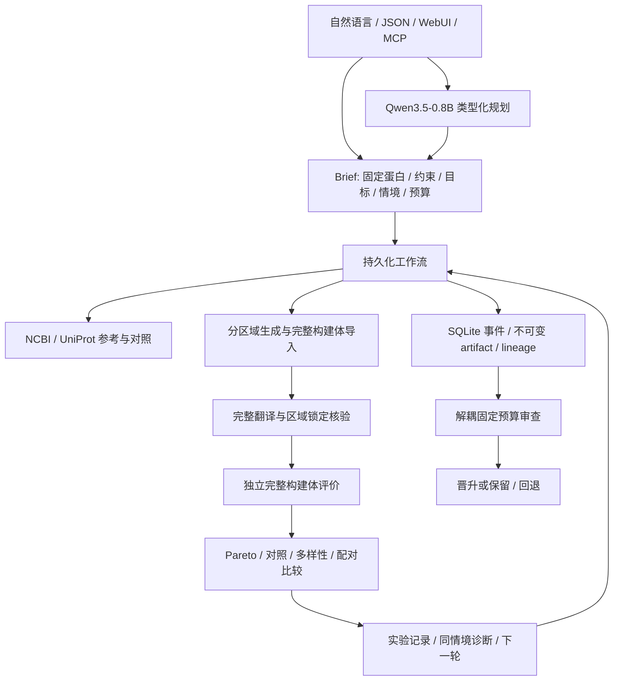

# 架构与证据语义

[原文](architecture.md) | [简体中文](architecture_zh.md)

| 父项目边界 | mRNA 实现 |
| --- | --- |
| Master agent 与执行层分离 | `llm.py` 仅返回受 schema 约束的意图/重点；`workflow.py` 执行固定工具流程 |
| 类型化协议 | `contracts.py` 的 Brief、Regions、Construct、Context、Measurement；禁止未知字段、NaN/Inf |
| 工具注册与执行预算 | `registry.py` 的能力档案；`gateway.py` 固定 allowlist、调用计数、超时、失败计费和 hash |
| 科学执行 | `scientific_worker.py` 固定 JSON 协议；官方权重在兼容环境执行；无任意命令或用户 pickle 路径 |
| 独立评价层 | `evaluation.py` 全翻译、分区/边界、结构、适用范围、来源一致的 Pareto 比较 |
| 证据与恢复层 | `storage.py` SQLite WAL、run 锁、事件、分阶段 checkpoint、SHA256 artifacts |
| 任务内反馈 | 有界轮次、父构建体、相同目标/锁定规则、差异候选池 |
| 实验反馈 | `feedback.py` 原始读数、同情境/批次/对照聚合、预测秩诊断、下一批和独立校准 |
| 解耦进化 | `benchmark.py` 冻结任务与规则；候选流程只改变已允许的组合顺序 |
| 接口 | `cli.py`、`web.py`/`web_worker.py`、`mcp_server.py` 共用同一工作流 |

## 身份与边界

构建体 ID 为标准化分区序列与分子配置的 SHA256。序列 ID 单独针对包括显式 poly(A) 的完整 A/C/G/U 序列计算。候选名、情境、生成来源和 protein-version 别名不改变分子身份；cap、修饰或 poly(A) 配置改变会产生新的构建体 ID。评价另绑定 context ID；换细胞不会产生一个假的新分子。

`Regions.cds` 必须有 AUG 和完整终止密码子，不接受内部 stop、模糊核苷酸或非同义变化。DNA T 规范化为 U。分区坐标采用 0-based half-open；`[0,18)` 固定前六个完整密码子。任意非三倍数锁定也会逐碱基保留，再以完整翻译检查跨密码子影响。GEMORNA/LinearDesign 不提供终止密码子时，assembly 显式添加 UAA 并留下来源说明。

基线、模块组合和 `joint_proposals` 全部经过同一最终评价函数。联合输入不触发未经验证的托管服务；provider/source/version/request_id 仅为调用方提供的来源。即使输入已声称“设计完成”，也必须通过本地完整翻译和用户固定约束。

## 评价与排序

`Measurement` 每条记录有 metric、status、value、unit、source、version、scope、evidence、provenance、uncertainty。只有 `status=ok` 可以有数值；失败或超范围不能给出零。所有模型支持范围可通过 doctor 或 `/api/capabilities` 查询。

结构指标以完整分子为基础，起始区未配对概率来自同一全分子结构集合；相关结构指标不被描述成独立验证。LinearDesign 使用的 MFE/CAI 标记为优化相关证据。Smart5UTR 与 Optimus5 共享 MPRA 谱系；Smart5UTR 生成候选的 Optimus5 评价不包装成独立数据验证。`independent` 主要表示没有作为该候选的优化奖励；并不证明训练样本之间完全不重叠。

完整评价后必须通过 [high-potential-v1](high-potential-policy.md)。至少两个独立预测器、完整结构评价、无待定硬约束、相同情境与配置的基线，以及主要目标定向改善阈值均满足后，才进入 Pareto/序列多样性选择。未知指标不能被当成零，也不能用探索名额绕过筛选。参考对照仍保存于内部审计，不作为新推荐提交。`delivery.public_run` 为 WebUI/API/CLI/MCP/导出共同边界，在读取时重新核查；未完成、旧协议和失败任务无候选序列输出。

实验硬约束在没有实际证据时为 `pending`。计算约束通过、仍有待验证约束、真实实验是否达标分别记录。没有完整匹配证据时 `experimental_success` 始终为 false；当前不会从零散读数自动认证蛋白功能、质量或最终任务成功。

## 实验与校准

导入字段：construct_id、context、metric、value、unit、time_hours、batch、replicate、control_id、study、assay、quality、dataset_role。完整批次先校验后以事务写入；重复身份/相同数据幂等，重复身份/冲突数值拒绝覆盖。

分析仅合并同一 context、endpoint、单位、时间、批次、研究、assay 和对照的重复。只有同组存在有效对照时才计算 baseline delta。技术失败、制备失败、质量不合格、missing 及 synthetic_fixture 分别保留，不进入效力秩分析。可比较测量不足时不拟合“校准后的精确倍数”。

校准工具需要明确 group 和 split；同一 protein/family/batch/source group 不能跨 train/calibration/test。拟合仅用 train，区间半径只用 calibration，test 只用来报告 MAE/coverage。小 calibration 集无法支持有限 90% conformal 区间时，返回无界状态，不伪造精确不确定性。输入分组的真实性需要原始数据提供方负责，工具不会把自由填写的 group 当作已经完成生物学泄漏审计。

## 恢复、预算、版本与磁盘

单个 run 使用 Linux flock 排他执行；WebUI 全局队列串行启动工作进程，暂停/取消时终止整个进程组。进程重启后，只有不再有活跃执行锁的中断任务标为 paused。恢复复用完成的 generation/prediction/evaluation checkpoint；科学调用的失败也计入持久化预算。

原始工具输出保存为 artifact，当前状态是可更新 checkpoint。重评估建立新的 run/evaluation，不改写原始预测。分子去重与候选来源记录分别处理，相同分子可以在不同运行中有不同设计谱系。

新增下载、artifact 和 journal 写入检查 50,000,000,000-byte 总配额；安装脚本在安装前预留空间。外部进程由固定 adapter 约束输入和输出规模。该配额是应用层限制，并非操作系统对其他用户进程设置的硬盘 quota；用户自行在目录写入大文件仍需自行遵守上限。当前实际磁盘使用远低于上限。

## 官方资源

- [GEMORNA](https://github.com/RainaBio/GEMORNA)：CDS、5UTR、3UTR 权重与作者生成入口。
- [LinearDesign](https://github.com/LinearDesignSoftware/LinearDesign)：原生 C++ 优化器及 human codon table。
- [RiboNN](https://github.com/Sanofi-Public/RiboNN) 与 [官方权重记录](https://zenodo.org/records/17258709)：全转录本 TE 任务与输入上限。
- [Smart5UTR](https://github.com/deepomicslab/Smart5UTR)：m1Ψ 5UTR 模型、Optimus5 checkpoint、GSM3130440 数据和作者划分。
- [PARADE](https://github.com/autosome-ru/parade)：5UTR/3UTR 特定细胞活动预测器。
- [ViennaRNA](https://www.tbi.univie.ac.at/RNA/)：结构集合和配对概率。
- [NCBI HBB](https://www.ncbi.nlm.nih.gov/nuccore/NM_000518.5)、[UniProt GFP](https://www.uniprot.org/uniprotkb/P42212/entry)、[UniProt luciferase](https://www.uniprot.org/uniprotkb/P08659/entry)：来源明确的参考，不用作虚构的工程测量标签。

新增模型的版本、输入语义和本地部署限制见 [可选模型](optional-models.md)。
