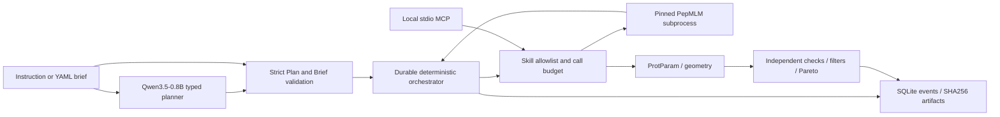

# Architecture correspondence

[English](architecture.md) | [简体中文](architecture_zh.md)

Parent references: `../../../README.md`, `../../drug-agent/src/drug_agent/contracts/agent.py`,
and the parent README's four-plane contract. This package does not import `drug_agent` or mutate its configuration.

| Parent boundary | Peptide implementation |
| --- | --- |
| Master agent plans, specialists execute | `llm.py` emits `Plan`; `workflow.py` owns design/analysis/evaluation stages |
| Typed contracts | `contracts.py`: brief, requests, tool result, constraints |
| Scientific tool registry | `gateway.py`: fixed tool schema table, capability-to-skill permissions |
| Execution plane | `models.py` / fixed subprocess `worker.py`; `analysis.py` |
| Evidence plane | `store.py`: append-only events and content-addressed results |
| Evaluation plane | `analysis.rank` and independent result checks in `workflow.py`; held-out `benchmark.py` |
| External access | `mcp_server.py`, shared Gateway with fixed endpoint skill identity |

Skills are packaged procedural context, not executable permission grants. Model-provided role names,
commands and scientific outputs have no field in the accepted plan. LM Format Enforcer constrains
tokens to the JSON schema; Pydantic also checks semantic skill/source consistency. Qwen gets two bounded attempts;
invalid plans fail closed. Runtime generation is local-only, in a subprocess bounded at 300 seconds for PepMLM and 1800 seconds for BoltzGen (Web worker budget 2400 seconds).
This is application-level tool containment, not an OS sandbox for arbitrary third-party Python plugins.

The workflow persists completed generation/analysis stages. Resume reuses them; a crash between a tool
side effect and checkpoint can repeat that stage (at-least-once, not exactly-once execution).
Each new process re-reads persisted call counts. A failed attempt consumes budget.
One workflow should have one active executor; concurrent resume of the same run is not currently supported.
MCP requests use individual operation IDs rather than resumable design briefs.

To add a backend, add a strict input contract, a fixed callable, explicit skill permissions,
provenance and an unavailable state. Verify a backend on the deployment before advertising it as executable.
Do not expose a generic shell bridge merely to make unverified model repositories appear supported.

The local FastAPI UI mirrors the parent console: task launch, stage progress, candidate portfolio,
evidence journal and history. A single process queue serializes Web jobs. Cancellation terminates
the worker process group, including scientific subprocesses. Seven MCP tools and the Web API share
Gateway policy/schema validation. A target chain is normalized back to the requested ID and the
peptide to B; raw CIF-to-PDB mapping is preserved. Head-to-tail PDB exports include closure CONECT.
BoltzGen design masks determine chain identity; chain length is never used as identity evidence.
