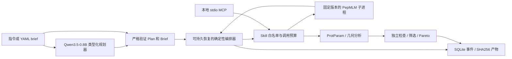

# 架构对应关系

[English](architecture.md) | [简体中文](architecture_zh.md)

父项目参考：`../../../README.md`、`../../drug-agent/src/drug_agent/contracts/agent.py`，以及父项目 README 中的四层契约说明。本包不导入 `drug_agent`，也不修改其配置。

| 父项目边界 | Peptide 实现 |
| --- | --- |
| Master Agent 规划，专用 Agent 执行 | `llm.py` 生成 `Plan`；`workflow.py` 管理设计、分析和评估阶段 |
| 类型化契约 | `contracts.py`：brief、请求、工具结果与约束 |
| 科学工具注册表 | `gateway.py`：固定工具 schema 表、能力到 skill 的权限映射 |
| 执行层 | `models.py` / 固定子进程 `worker.py`；`analysis.py` |
| 证据层 | `store.py`：仅追加事件和内容寻址结果 |
| 评估层 | `analysis.rank`、`workflow.py` 中的独立结果检查；留出评估 `benchmark.py` |
| 外部访问 | `mcp_server.py`，共用 Gateway，并为端点固定 skill 身份 |

Skill 是随包提供的流程上下文，不是可执行权限授权。已接受的 plan 没有用于容纳模型给出的角色名、命令或科学输出的字段。LM Format Enforcer 将 token 限制在 JSON schema 内；Pydantic 还会检查 skill/source 的语义一致性。Qwen 最多尝试两次，无效计划直接拒绝。运行时生成仅在本地子进程进行：PepMLM 上限 300 秒，BoltzGen 上限 1800 秒（Web worker 预算 2400 秒）。这属于应用层工具约束，不是用于任意第三方 Python 插件的操作系统沙箱。

工作流持久化已完成的生成/分析阶段，恢复时复用它们。如果工具副作用发生后、保存检查点前崩溃，该阶段可能再次执行，即“至少一次”，而非“恰好一次”。每个新进程重新读取持久化调用计数；失败尝试也消耗预算。一个工作流应只有一个活跃执行器，目前不支持对同一运行并发恢复。MCP 请求使用独立操作 ID，不使用可恢复的设计 brief。

新增后端需要严格输入契约、固定可调用入口、明确的 skill 权限、来源记录和不可用状态。只有在部署环境验证后端后，才能将其标为可执行。不要为了让未经验证的模型仓库看似受支持而开放通用 shell 桥接。

本地 FastAPI UI 对应父项目控制台：任务启动、阶段进度、候选组合、证据日志和历史记录。单进程队列串行处理 Web 任务。取消会终止 worker 进程组及其科学子进程。七个 MCP 工具与 Web API 共用 Gateway 策略/schema 验证。靶点链会规范化为请求的 ID，肽链规范化为 B；保留原始 CIF 到 PDB 的映射。首尾相连的 PDB 导出包含闭环 CONECT。BoltzGen 设计 mask 决定链身份，链长从不用作身份依据。

